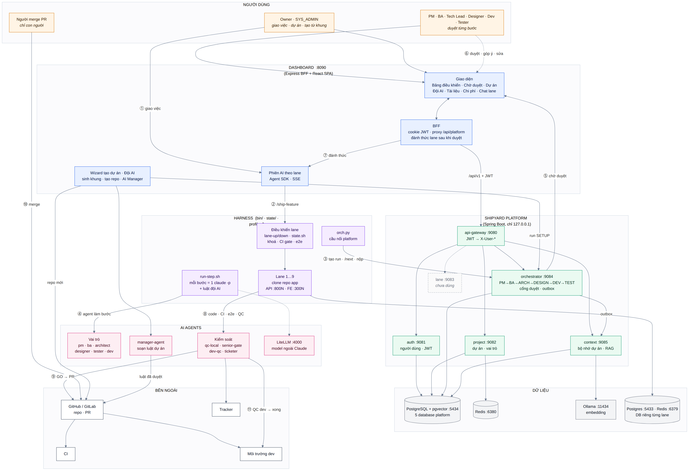

# Shipyard — xưởng AI làm phần mềm song song

Shipyard biến một ý tưởng hoặc một repo có sẵn thành phần mềm chạy được, do **một đội AI** làm
(PM, BA, kiến trúc sư, thiết kế, lập trình, kiểm thử) và **con người duyệt** ở những bước quan trọng.
Mỗi tính năng được làm trong một **lane** riêng (bản clone đầy đủ của dự án, có cổng, database, phiên
AI riêng), nên nhiều tính năng chạy song song mà không giẫm chân nhau. Mọi thứ điều khiển trên
**dashboard** tiếng Việt; repo của bạn chỉ nhận pull request — con người merge.



```
Ý tưởng / repo có sẵn ─► dự án (tài liệu đã duyệt + quy trình riêng)
   └─► lộ trình tính năng ─► giao cho lane rảnh
         PM ─► BA ─► Kiến trúc ─► Thiết kế UI ─► Code ─► Test        (bước nào chạy, ai duyệt: theo quy trình dự án)
         └─► CI + e2e ─► review code ─► QC trình duyệt ─► GO/NO-GO ─► PR vào nhánh tích hợp ─► người merge
```

---

## Bắt đầu một dự án — ba cách

| Cách | Dùng khi | Ở đâu trên dashboard |
|---|---|---|
| **Chat ý tưởng** | Mới có ý tưởng | **Ý tưởng sản phẩm** — AI PM viết yêu cầu → AI kiến trúc sư tư vấn công nghệ + thiết kế hệ thống + đề xuất quy trình → AI thiết kế vẽ mockup → bạn duyệt từng bước trong chat → **Tạo dự án** → **Lộ trình tính năng** giao cho lane |
| **Tạo từ khung** | Biết rõ công nghệ muốn dùng | **Dự án → Tạo dự án từ khung** — chọn ngôn ngữ, framework (Spring Boot, FastAPI, NestJS, React + Vite; fullstack backend + frontend), database, kho Git; có thể nhờ AI tư vấn, duyệt kiến trúc trước khi sinh code |
| **Nhập repo có sẵn** | Dự án đã có code trên GitHub/GitLab/máy | **Dự án → Thêm hoặc liên kết dự án → Nhập dự án có sẵn từ Git** — bạn tự khai cách cài, chạy, build, test, kiểm tra, database, biến môi trường và **tài liệu nằm ở đâu**; Shipyard clone, kiểm tra, sinh script cho lane, đăng ký dự án và (tuỳ chọn) để AI Manager đọc code soạn luật |

Dự án mới được tạo ở `~/shipyard-workspaces/<slug>` (đổi bằng `SHIPYARD_WORKSPACES`), có hai nhánh
`main` và `development`; nếu chọn GitHub/GitLab thì repo được tạo và push lên đó. Lỗi khi tạo dự án
(mạng, build, tên repo trùng…) có **Thử lại** hoặc **Quay lại bước Tạo dự án** — tài liệu đã duyệt
và quy trình vẫn giữ.

### Tài liệu đã duyệt là chuẩn

Những gì người đã duyệt trước khi có code — yêu cầu sản phẩm, kiến trúc, hướng dẫn thiết kế, mockup —
được đưa cho **mọi bước** của lane kèm quy tắc riêng: PM/BA không vượt phạm vi yêu cầu; thiết kế lấy
mockup đã duyệt làm gốc, **không vẽ lại**; code làm **giống mockup** và đúng kiến trúc; test và QC trình
duyệt so với mockup. Vị trí tài liệu:

- dự án từ chat ý tưởng: `docs/product-brief.md`, `docs/architecture.md`, `docs/design/design.md`, `docs/design/mockups/`;
- repo nhập vào: theo đường dẫn bạn khai ở bước **Tài liệu** (Shipyard kiểm tra từng file có thật khi clone);
- thêm/sửa sau này: ghi vị trí vào `.shipyard/docs.json` trong repo (`brief`, `architecture`, `design`, `mockups`, `other`).

---

## Quy trình làm tính năng — mỗi dự án một quy trình

Quy trình được chọn khi tạo dự án (trong wizard, trong chat ý tưởng — nhắn AI kiểu *"bước Test dùng
Haiku, tối đa 30 phút, lỗi thì thử lại 2 lần"* — hoặc khi nhập repo) và sửa ở **Quy trình & duyệt**.
Có mẫu nhanh (Đầy đủ, Plan → Code → Test, Tự chạy hết, Thiết kế UI → Code → Test, Chỉ Code + Test, Doanh
nghiệp) và ba cách xem: **Sơ đồ** (bấm một bước để cấu hình), **Bảng chi tiết**, **6 giai đoạn** (kéo thả).

Mỗi bước (PM, BA, Kiến trúc, Thiết kế, Code, Test) có:

| Cài đặt | Hệ thống làm gì |
|---|---|
| Chế độ | **Cần duyệt** (người có vai trò được chọn, hoặc một người cụ thể) · **Tự qua khi xanh** · **Bỏ qua** |
| Model AI | Chọn sẵn khi giao việc cho lane (Claude Opus/Sonnet/Haiku, hoặc OpenHands qua cổng LiteLLM) |
| Giới hạn phút | Lần chạy AI quá giờ bị cắt |
| Ngân sách (₫) | Đã tiêu tới trần thì không chạy thêm |
| Số vòng thử lại | Khi chọn "Tự thử lại" |
| Điều kiện chạy | Luôn chạy · Chỉ khi tính năng có giao diện · Chỉ khi bước trước đạt |
| Khi lỗi | Chuyển con người · Tự thử lại · Dừng cả quy trình |
| Đầu vào bắt buộc | Thiếu file thì dừng trước khi tốn token; AI chỉ được dặn đọc đúng các file đó |

Mỗi lần chạy **đóng băng** quy trình tại thời điểm bắt đầu — sửa quy trình chỉ áp dụng cho lần sau.
Điều kiện chạy do orchestrator áp; giới hạn, ngân sách, thử lại, đầu vào do lane (`bin/run-step.sh`,
`bin/step_guard.py`) áp.

### Tài khoản AI

**Nhà cung cấp AI → Claude chạy bằng**:

- **Tài khoản Claude đăng nhập trên máy** (mặc định) — không dùng API key.
- **API key Anthropic khi có** — có key hợp lệ (`sk-ant-api…`) thì dùng key; chưa có key, key sai hoặc hết
  tiền thì tự quay về tài khoản đăng nhập (key bị bỏ qua 1 tiếng rồi thử lại).

Bước nào chọn model **OpenHands · …** thì chạy OpenHands trong hộp kín, qua cổng LiteLLM, bằng API key của
nhà cung cấp đó (OpenAI, Gemini, DeepSeek, Anthropic…). Key chỉ lưu trên máy (`config/providers.json`, quyền 600),
trình duyệt chỉ thấy 4 ký tự cuối.

---

## Thành phần & cổng

| Thành phần | Cổng | Khởi động |
|---|---|---|
| **Dashboard** (Express + React) | 8090 | `bin/dashboard.sh start\|restart [port]` |
| **Shipyard Platform** — api-gateway | 9080 | `bin/platform.sh start` |
| auth · project · lane · orchestrator · context service | 9081–9085 | 〃 (Spring Boot, Java 21) |
| Postgres + Redis của platform | 5434 / 6380 | `bin/platform.sh infra-up` (Docker) |
| Ollama (embedding `bge-m3` cho bộ nhớ dự án) | 11434 | native hoặc container |
| Cổng LiteLLM (OpenHands, nhà cung cấp khác) | 4000 | `bin/gateway.sh` (tự bật khi cần) |
| Postgres + Redis cho lane | 5433 / 6379 | `bin/db-shared-up.sh` |
| Lane N — API / frontend | `8000+N` / `3000+N` | nút **▶ up** hoặc `bin/lane-up.sh N` |

- **Orchestrator** giữ quy trình, các lần chạy, cổng duyệt, và việc "Chờ tôi duyệt".
- **Context service** là bộ nhớ dự án: bài học, phản hồi của người duyệt, đồ thị thực thể → mỗi bước nhận một
  "context pack" gọn (xem [nguyên lý & bộ nhớ dự án](docs/nguyen-ly-hoat-dong-va-bo-nho-du-an.md)).
- **Lane** chạy Claude Code (`/ship-feature`) cùng các agent vai trò trong `claude/agents/`.

---

## Cài đặt

### Cần có

| Công cụ | Để làm gì |
|---|---|
| **git**, **Docker** | lane, database dùng chung, hạ tầng platform |
| **Java 21 + Maven** | build và chạy Shipyard Platform |
| **Node ≥ 20** | dashboard, Playwright MCP (QC trình duyệt), dự án Node |
| **python3** | các script trong `bin/` (chỉ thư viện chuẩn) |
| **Claude Code** (đã đăng nhập) | phiên của lane và các bước AI |
| **gh** (đã đăng nhập) | PR, trạng thái CI, vòng review |
| **flock** | khoá giữa các lane (macOS: `brew install flock`) |
| Công cụ của dự án | JDK, uv, composer… — gọi qua script lane của từng dự án |

### Cấu hình — thư mục `config/`

- **`config/local.env`** (không commit) — cấu hình của máy. Tối thiểu, cho dự án chính của máy:
  ```bash
  PROFILE="${PROFILE:-myapp}"                    # profiles/myapp/
  SOURCE_REPO="${SOURCE_REPO:-$HOME/work/myapp}" # repo mà lane clone
  LANES_ROOT="${LANES_ROOT:-$HOME/work}"         # nơi tạo laneN/
  DB_PREFIX="${DB_PREFIX:-myapp_l}"              # DB của lane N = myapp_l<N>
  ```
  Dự án tạo/nhập trên dashboard có profile riêng; lane gắn với dự án nào thì ghi ở `config/lanes/laneN.env`.
- **`config/secrets.env`** (không commit) — `cp config/secrets.env.example config/secrets.env`, điền tài khoản seed,
  QC, tracker, `ADMIN_EMAIL` / `ADMIN_PASSWORD` (mặc định `admin@shipyard.local` / `admin123` — **đổi đi**).
- API key nhà cung cấp AI và token GitHub/GitLab nhập trên dashboard, **không** ghi vào file tay hay dán vào chat.

### Khởi động

```bash
bin/platform.sh infra-up          # Postgres/Redis/RabbitMQ của platform (Docker)
bin/platform.sh start             # 6 service (lần đầu tự build bằng Maven)
bin/db-shared-up.sh               # Postgres + Redis dùng chung cho các lane
bin/install-claude-assets.sh      # chép skill + agent vào ~/.claude (+ plugin superpowers)
bin/dashboard.sh start            # → http://127.0.0.1:8090, đăng nhập bằng tài khoản admin
```

> `install-claude-assets.sh` và `lane-agents-install.sh` **chép** skill/agent (không symlink). Sửa file trong
> `claude/` xong thì chạy lại `bin/install-claude-assets.sh`, bấm **♻ agents** cho từng lane (hoặc
> `bin/lane-agents-install.sh --all`) rồi **mở lại** phiên Claude của lane.

**Mở dashboard cho mạng LAN:** thêm `DASHBOARD_HOST="${DASHBOARD_HOST:-0.0.0.0}"` vào `config/local.env`, chạy
`bin/platform.sh start` (tạo JWT secret riêng của máy), rồi `bin/dashboard.sh restart` — lệnh in ra địa chỉ LAN.
Chỉ dashboard mở ra ngoài; platform và gateway vẫn ở 127.0.0.1. Tài khoản do admin tạo ở **Người dùng**.

> Khởi động lại dashboard luôn dùng `bin/dashboard.sh restart` (không chạy `node` trực tiếp — sẽ mất PROFILE).
> Khởi động lại một service platform: `bin/platform.sh restart` (hoặc dừng pid trong `run/platform/` rồi `start`).

---

## Dùng hằng ngày

| Màn hình | Để làm gì |
|---|---|
| **Tổng quan** · **Lanes** | Thẻ từng lane: tính năng, giai đoạn, sức khoẻ stack, nhánh, CI, PR, nhịp tim; nút ▶ up · ■ down · 🧹 clear · ♻ agents · 🔑 creds · ⟳ reset · 🗑 remove · ＋ thêm lane |
| **Giao việc mới** | Giao một yêu cầu (hoặc spec có sẵn) cho lane; model từng bước lấy theo quy trình dự án |
| **Chờ tôi duyệt** | Tài liệu từng bước (spec, BA, plan, thiết kế + ảnh, qc-plan) chờ bạn: duyệt, yêu cầu sửa, sửa trực tiếp |
| **Ý tưởng sản phẩm** | Chat từ ý tưởng tới dự án và lộ trình (bản nháp ở `run/studio/`) |
| **Dự án** | Thành viên & vai trò, **Quy trình & duyệt**, **Tính năng & model AI**, **Tài liệu đã duyệt**, **Bộ nhớ dự án**, **Kỹ năng AI & khung**, đội AI (luật do AI Manager soạn, người duyệt) |
| **Chi phí & hạn mức** | Token và tiền theo dự án, tính năng, lane, model |
| **Nhà cung cấp AI** | Claude chạy bằng tài khoản hay API key; key các nhà cung cấp; model mặc định từng bước / từng lane |

Lane chạy không cần trông; chỉ dừng khi cần người (cổng duyệt, NO-GO, xung đột merge mơ hồ) — lý do hiện ở
**notes** của thẻ. Mỗi lane có app thật ở `http://localhost:300N` để bạn tự thử.

---

## Dự án và file nằm ở đâu

| Thứ | Vị trí |
|---|---|
| Code dự án (bản gốc lane clone từ đó) | `~/shipyard-workspaces/<slug>` |
| Bản làm việc của lane | `$LANES_ROOT/laneN` |
| Script lane của dự án (profile) | `profiles/<slug>/` |
| Thông tin khai khi nhập repo | `config/imports/<slug>.json` |
| Vị trí tài liệu của repo nhập | `profiles/<slug>/project-docs.json` (hoặc `.shipyard/docs.json` trong repo) |
| Bản nháp chat ý tưởng | `run/studio/stu_<id>.json` + thư mục `stu_<id>/` |
| Luật đội AI của dự án | `.shipyard/rules/*.md`, `.shipyard/team.json` trong repo dự án |
| Ảnh QC, báo cáo | `<lane>/.playwright-mcp/proof/<tính-năng>/` |

---

## Profile & script lane

Mọi thứ riêng của một dự án nằm trong **profile** `profiles/<name>/` (không commit; chỉ `_template` có trong git).
Dự án tạo hoặc nhập trên dashboard có profile **tự sinh**; dự án cấu hình tay (như dự án chính của máy) thì
chép `profiles/_template`, điền `profile.env`, viết các hook — hoặc chạy `/harness-adapt` trong Claude Code để
nó đọc repo và soạn giúp. Kiểm tra: `bin/harness-doctor.sh <name>`.

| File | Nội dung |
|---|---|
| `profile.env` | hình dạng stack: thư mục backend/frontend, nhánh tích hợp, image OpenHands, file test… |
| `hooks/*.sh` | các bước riêng của dự án (bảng dưới) |
| `integrations.env` | `PLATFORM_PROJECT_ID`, tracker, QC trên dev site, chờ deploy CI (tắt ⇒ bỏ qua bước đó) |
| `project-docs.json` | (tuỳ chọn) vị trí tài liệu đã duyệt |
| `review-checks.md`, `tracker-notes.md` | (tuỳ chọn) kiểm tra riêng cho review, ghi chú tracker |

Trước khi gọi hook, lane export: `LANE`, `LANE_DIR`, `API_PORT`, `FE_PORT`, `DATABASE_URL`, `REDIS_URL`,
`UPLOAD_DIR`, `DB_NAME`, `API_BASE`, `FE_URL`, `RUN_DIR`, `LOG_DIR`, `PROFILE_DIR`, `SOURCE_REPO`,
`HARNESS_ROOT`, `PG_*`, `REDIS_*` và mọi khoá trong `profile.env`; có sẵn `harness_spawn <tên> <thư-mục> <lệnh…>`
(chạy nền, ghi pid/log — dùng trong `boot`) và `die <thông báo>`.

| Hook | Phải làm |
|---|---|
| `bootstrap` | cài thư viện trong bản clone của lane |
| `migrate` | áp migration vào DB của lane |
| `seed` | tạo dữ liệu/tài khoản ban đầu (`SEED_USER_*`) |
| `boot` | build + chạy dịch vụ nền rồi **trả về** (`harness_spawn`; `$1 == --no-build` ⇒ dùng lại build) |
| `health` | exit 0 khi app sẵn sàng (`curl --retry`) |
| `ci-gate` | lint / test; lỗi ⇒ exit khác 0 (có `TEST_DATABASE_URL` riêng) |
| `e2e` | e2e trên stack đang chạy, dưới khoá `with-lock.sh e2e -- <lệnh>` |

Repo nhập vào: các hook được sinh **đúng từ lệnh bạn khai** (lệnh chạy dùng `$PORT` để mỗi lane một cổng);
sửa trực tiếp trong `profiles/<slug>/hooks/` nếu cần (xoá dòng `SHIPYARD_GENERATED=1` trong `profile.env` để
Shipyard không sinh lại).

### Tích hợp (trong `integrations.env`, mặc định tắt)

- **Tracker** (`TRACKER_ENABLED=1`) — tạo ticket khi mở PR (`TRACKER_PROVIDER`, `TRACKER_URL`, `TRACKER_PROJECT`, …).
- **QC trên dev site** (`DEV_QC_ENABLED=1`) — sau khi người merge, QC trình duyệt trên bản đã deploy (`DEV_SITE_URL`).
- **Chờ deploy CI** (`CI_WAIT_ENABLED=1`) — chờ một commit status (`CI_REPO`, `CI_DEPLOY_CONTEXT`) trước dev-QC.

---

## Xử lý sự cố

| Hiện tượng | Cách xử lý |
|---|---|
| Lane báo **DEAD** | Phiên Claude của lane đã chết — `cd $LANES_ROOT/laneN && claude` để tiếp tục |
| Bước AI dừng "thiếu đầu vào bắt buộc" / "vượt ngân sách" / "quá giới hạn" | Do cài đặt bước trong **Quy trình & duyệt**; bổ sung file hoặc nới giới hạn rồi chạy lại |
| Tạo dự án lỗi `npm … ECONNRESET` | Mạng tới npm registry bị ngắt — **Thử lại** hoặc **Quay lại bước Tạo dự án** khi mạng ổn |
| Lane của repo nhập không lên | Xem `logs/laneN/*.log`; sửa lệnh trong `profiles/<slug>/hooks/` |
| "API key Anthropic lỗi" | Key sai/hết tiền — hệ thống tự quay về tài khoản đăng nhập; với phiên chính của lane: dừng rồi mở lại phiên |
| Dashboard báo không kết nối được platform | `bin/platform.sh status`, rồi `bin/platform.sh start` |
| Thiếu MCP trong phiên lane | `bin/lane-mcp-sync.sh N`, mở lại phiên Claude |
| Sửa agent/skill mà lane không đổi | `bin/install-claude-assets.sh`, **♻ agents**, mở lại phiên |

---

## Lệnh CLI

```bash
# Hệ thống
bin/platform.sh infra-up|start|stop|restart|status|build
bin/dashboard.sh start|stop|restart [port]
bin/db-shared-up.sh
bin/install-claude-assets.sh
bin/gateway.sh start|stop                 # cổng LiteLLM
bin/harness-doctor.sh [profile]

# Lane (cũng có trên dashboard)
bin/lane-add.sh [--and-up] [--profile P --source REPO]
bin/lane-up.sh N [--qc] | bin/lane-down.sh N
bin/lane-reset.sh N | bin/lane-remove.sh N
bin/lane-status.sh
bin/lane-agents-install.sh N|--all
bin/lane-mcp-sync.sh N|--all

# Pipeline (lane dùng; hữu ích khi gỡ lỗi)
bin/orch.sh N next|pack|submit|fail …     # nói chuyện với orchestrator
bin/run-step.sh N <bước> <prompt-file>     # chạy một bước AI có giới hạn của quy trình
bin/project-docs.sh N <bước>               # xem tài liệu đã duyệt mà bước đó nhận
```

Kiểm thử: `bash tests/run.sh` (script lane + dashboard), orchestrator: `mvn -f platform/pom.xml test`.

---

## Tài liệu chi tiết

- [Hướng dẫn từ đầu đến cuối](docs/huong-dan-tu-dau-den-cuoi.md) — tạo dự án, thêm lane, giao và duyệt tính năng
- [Hướng dẫn dashboard, lane và agent](docs/huong-dan-shipyard.md)
- [Thiết kế hệ thống](docs/thiet-ke-he-thong.md) — service, API, cơ sở dữ liệu, luồng
- [Nguyên lý hoạt động & bộ nhớ dự án](docs/nguyen-ly-hoat-dong-va-bo-nho-du-an.md)
- [Các lệnh Shipyard](docs/lenh-shipyard.md)

## Không bao giờ vào git

`config/local.env`, `config/secrets.env`, `config/providers.json`, `config/imports/`, `profiles/<tên>/`
(chỉ `_template`), `run/`, `state/`, `logs/`, `locks/`, ảnh chụp dashboard, và file thông tin đăng nhập trong
từng lane (`<lane>/.harness-qa.env`, `<lane>/.claude/agents/*.md`). Mật khẩu, key và thông tin riêng của
dự án không đi vào repo này.
