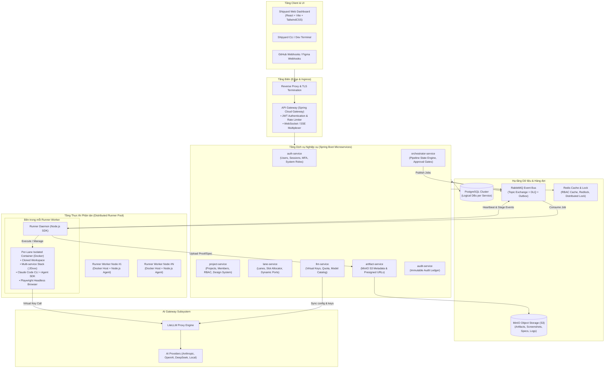
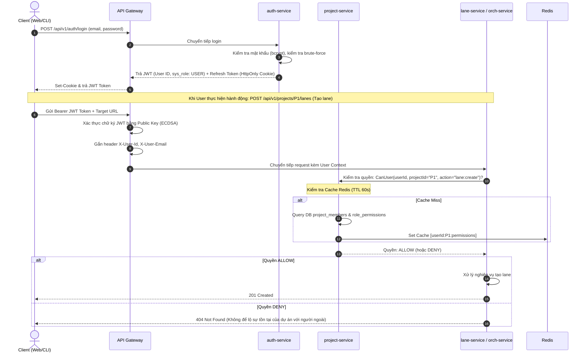
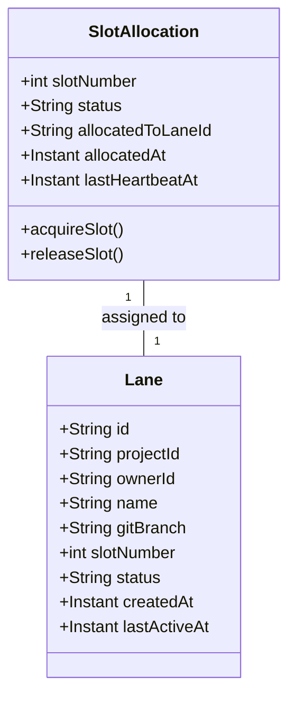
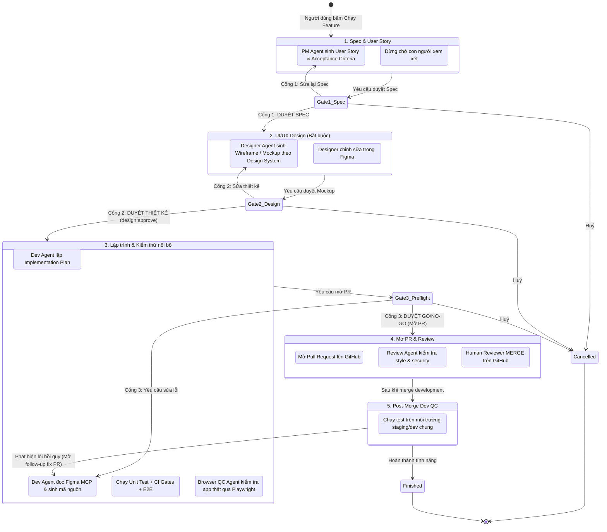
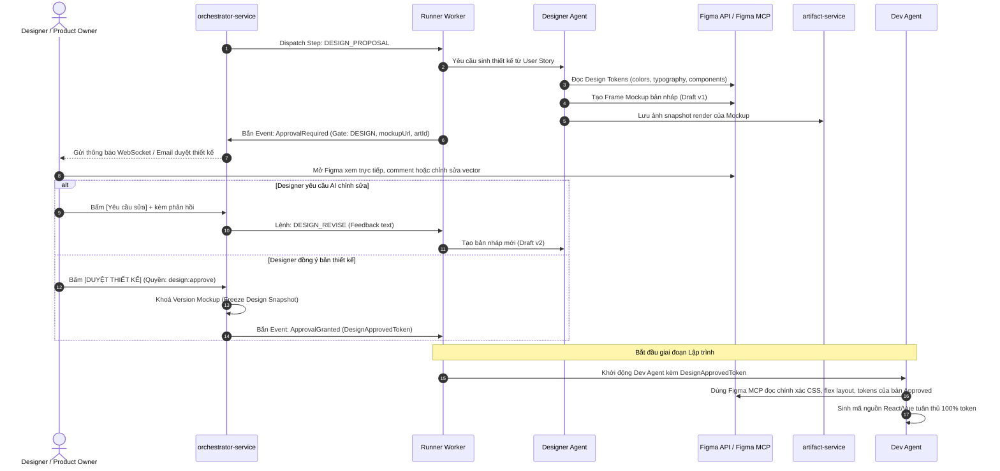
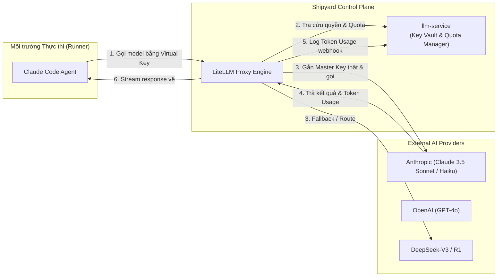
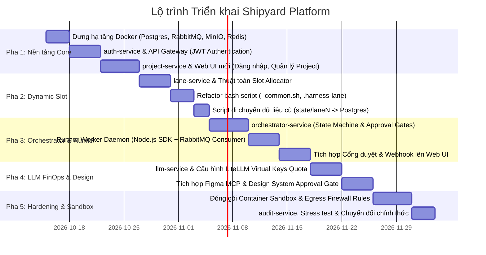

# Shipyard Platform – Thiết kế kiến trúc Microservices & Platform Engineering

**Tác giả:** @Trường & Architecture Team  
**Phiên bản:** 2.0 (Redesign)  
**Ngày cập nhật:** 14/10/2026  
**Trạng thái:** Architecture Proposal & Detailed Design Document  

---

## 1. Tổng quan & Tuyên bố bài toán (Problem Statement)

### 1.1. Hiện trạng của `shipyard-harness` (Legacy Monolith)
Harness hiện tại là một giải pháp tự động hoá quy trình phát triển tính năng (Parallel Feature Harness) rất hiệu quả cho cá nhân hoặc nhóm nhỏ chạy trên local machine. Tuy nhiên, qua phân tích mã nguồn repo, hệ thống bộc lộ các giới hạn kiến trúc nghiêm trọng:

1. **Bảo mật & Phân quyền yếu:**
   - Dashboard (Express + React) bind `127.0.0.1`, hoàn toàn không có authentication/authorization, chỉ chặn lỏng lẻo bằng `origin`.
   - Các API upload/preview ảnh QC (`/proof/...`, `/spec/...`) phục vụ trực tiếp từ ổ đĩa máy chủ không qua kiểm tra quyền.
   - API keys của các nhà cung cấp AI (`config/providers.json`) và tài khoản dev/QC/tracker (`config/secrets.env`, `.claude/agents/*.md`) lưu dạng plaintext thô trên disk của từng lane.
2. **Hạn chế Multi-tenant & Multi-project:**
   - Mỗi bản cài đặt chỉ trỏ vào đúng 1 dự án duy nhất thông qua các biến toàn cục trong `config/local.env` (`PROFILE`, `SOURCE_REPO`, `LANES_ROOT`).
   - Không hỗ trợ nhiều dự án chạy song song hoặc chia sẻ tài nguyên tính toán.
3. **Ràng buộc cứng Slot & Port (Hardcoded 1–9):**
   - Giới hạn cứng tối đa 9 lane qua regex `lane[1-9]`, route `:n(\\d)`, port cố định `8000+N` (API) và `3000+N` (Frontend), Redis index `0..15`.
   - Chỉ hỗ trợ mô hình cố định 1 Frontend + 1 Backend, không thích ứng được với các dự án microservices gồm 4-8 service con.
4. **Trạng thái phân mảnh (File-based State):**
   - Trạng thái pipeline lưu bằng file JSON phẳng trong `state/laneN/*.json`, dễ xảy ra race condition khi chạy song song và không có transaction.
5. **Coupling chặt giữa Điều phối (Orchestration) và Thực thi (Execution):**
   - Dashboard vừa hiển thị giao diện, vừa gọi trực tiếp các script bash nội bộ (`bin/*.sh`), buộc Dashboard và runner phải cùng nằm trên 1 máy vật lý có sẵn Docker và toolchain.

### 1.2. Mục tiêu thiết kế mới (Target Vision)
Hệ thống được tái thiết kế thành **Shipyard Platform** – một nền tảng **Cloud-Native AI-Augmented Engineering Platform** tuân thủ các tiêu chuẩn doanh nghiệp:
- **Zero-Touch Execution:** Giữ nguyên lõi runner kịch bản `bin/`, Claude Agent SDK và các skill đã hoàn thiện, đóng gói vào các **Runner Agent Container** phân tán.
- **Enterprise-grade Multi-Tenancy:** Đa dự án, đa tổ chức, phân quyền RBAC 2 tầng (Platform Role & Project Role).
- **Dynamic Slot & Network Virtualization:** Không giới hạn 9 lane; cấp phát dynamic slot, khối port tự động, cô lập database và Redis namespace theo lane.
- **Human-in-the-Loop as First-Class Citizen:** Cổng duyệt (Approval Gate) được quản lý qua máy trạng thái (State Machine), hỗ trợ Web notification & Webhook.
- **Tích hợp khâu Thiết kế UI/UX:** Tích hợp Figma MCP và Design System validation trước khi sinh mã nguồn.
- **Quản trị chi phí LLM (FinOps for AI):** Cấp phát Virtual Key tạm thời theo từng lượt chạy (Run), trần ngân sách mềm/cứng, định tuyến model thông minh qua LiteLLM Proxy.

---

## 2. Kiến trúc tổng thể hệ thống (System Architecture)

Shipyard Platform áp dụng kiến trúc **Event-Driven Microservices** kết hợp **Distributed Worker Pool**.

### 2.1. Sơ đồ khối kiến trúc (Architecture Diagram)



---

## 3. Danh mục Microservices & Phân định Trách nhiệm (Bounded Contexts)

Hệ thống được chia nhỏ thành 7 service nghiệp vụ viết bằng **Java 21 / Spring Boot 3.3+**, một cụm **Runner Workers (Node.js/Docker)** và hạ tầng phụ trợ:

| Service | Công nghệ | Database | Trách nhiệm chính (Single Responsibility) |
|---|---|---|---|
| **api-gateway** | Spring Cloud Gateway, Netty | Redis | Cổng vào duy nhất, xác thực JWT, định tuyến, rate limit, SSL termination, proxy SSE/WebSocket events đến trình duyệt. |
| **auth-service** | Spring Boot, Spring Security | `auth_db` | Quản lý định danh người dùng toàn hệ thống, mật khẩu bcrypt, phát hành/xoay vòng JWT access/refresh token, khoá brute-force, quản lý System Roles (`SYS_ADMIN`, `USER`). |
| **project-service** | Spring Boot, Hibernate | `project_db` | Quản lý dự án, kho mã nguồn (Git repo URL, branch settings), thành viên và phân quyền RBAC theo dự án, cấu hình profile dự án, tham chiếu secrets, cấu hình Design System tokens. |
| **lane-service** | Spring Boot, Spring Data JPA | `lane_db` | Quản trị vòng đời Lane, **Bộ cấp phát Slot động (Slot Allocator)**, phân bổ dải port và DB/Redis namespace cho từng lane, thu hồi tài nguyên rảnh rỗi. |
| **orchestrator-service** | Spring Boot, Spring StateMachine | `orchestrator_db` | Máy trạng thái điều phối pipeline chạy feature, quản lý hàng đợi Run, phát lệnh cho Runner, quản lý các điểm dừng duyệt (Human-in-the-Loop Approval Gates). |
| **llm-service** | Spring Boot, WebClient | `llm_db` | Quản lý kho khóa API nhà cung cấp (mã hoá AES-256-GCM), cấu hình bảng gán model (`models.json`), sinh Virtual Key ngắn hạn cho từng Run, giám sát hạn ngạch/ngân sách. |
| **artifact-service** | Spring Boot, MinIO SDK | `artifact_db` + MinIO | Quản lý siêu dữ liệu (metadata) của artefacts (ảnh chụp màn hình QC, spec markdown, logs, video recording), sinh Presigned URL an toàn (5 phút). |
| **audit-service** | Spring Boot, Spring Data JPA | `audit_db` | Ghi log kiểm toán bất biến (Append-only Ledger) phục vụ bảo mật, tuân thủ và đối soát chi phí/thao tác người dùng. |
| **Runner Worker** | Node.js 20+, Docker Engine, Claude Agent SDK | Local Disk / Volume | Daemon worker nhận job từ RabbitMQ, kích hoạt Docker container cách ly cho lane, gọi Claude Agent SDK, tương tác Git, phát heartbeat và sự kiện stage. |
| **LiteLLM Gateway** | LiteLLM (Python/FastAPI) | Redis | Proxy chuẩn hoá OpenAI-compatible cho toàn bộ các model LLM, xử lý retry, fallback và ghi nhận usage token chính xác. |

---

## 4. Xác thực & Phân quyền (Auth & Two-Tier RBAC)

Mô hình phân quyền tách biệt rõ ràng 2 tầng: **Danh tính toàn cục (Identity)** và **Quyền theo dự án (Project-scoped Permissions)**.



### 4.1. Cấu trúc JWT Payload
JWT chỉ mang định danh người dùng và quyền cấp hệ thống, **tuyệt đối không nhúng quyền dự án vào JWT** nhằm tránh stale token khi quyền của thành viên bị thay đổi:

```json
{
  "sub": "usr_9a8b7c6d5e",
  "email": "truong@company.com",
  "fullName": "Nguyen The Truong",
  "sysRole": "SYS_USER",
  "iss": "shipyard-auth-service",
  "iat": 1776150000,
  "exp": 1776150900
}
```

### 4.2. Ma trận Phân quyền theo Dự án (Project RBAC Matrix)

| Quyền hạn (Action) | Owner | Maintainer | Developer | Designer | Viewer |
|---|:---:|:---:|:---:|:---:|:---:|
| `project:view` |  |  |  |  |  |
| `project:update_config` |  |  | ❌ | ❌ | ❌ |
| `member:manage` |  | ❌ | ❌ | ❌ | ❌ |
| `lane:create_own` |  |  |  | ❌ | ❌ |
| `lane:view_all` |  |  |  |  |  |
| `lane:manage_any` |  |  | ❌ | ❌ | ❌ |
| `run:trigger_own` |  |  |  | ❌ | ❌ |
| `gate:approve_spec` |  |  | ❌ | ❌ | ❌ |
| `gate:approve_design` |  |  | ❌ |  | ❌ |
| `gate:approve_senior_pr`|  |  | ❌ | ❌ | ❌ |
| `gate:approve_budget` |  | ❌ | ❌ | ❌ | ❌ |
| `llm:manage_keys` |  | ❌ | ❌ | ❌ | ❌ |

> **Nguyên tắc bảo mật:** Người dùng không có quyền trong dự án khi cố gắng truy cập bất kỳ tài nguyên nào của dự án sẽ nhận về mã lỗi **404 Not Found** thay vì 403 Forbidden, ngăn chặn kẻ tấn công dò quét sự tồn tại của các dự án bí mật.

---

## 5. Quản lý Dự án, Lane & Bộ cấp phát Slot động (Slot Allocator)

### 5.1. Khái niệm Lane chính và Lane con
- **Main Lane (Lane chính):** Tạo tự động khi khởi tạo dự án. Liên kết với nhánh base (`development`). Dùng để chạy review liên tục (`/review-prs`), kiểm thử hồi quy và Dev QC sau khi PR được merge.
- **Feature Lane (Lane con cá nhân):** Do Developer tạo khi bắt đầu làm một tính năng. Liên kết với nhánh `feat/<username>/<feature-slug>`. Cô lập hoàn toàn về database, cache và cổng dịch vụ.

### 5.2. Thuật toán Cấp phát Slot Động (Dynamic Slot Allocation Algorithm)
Thay thế hoàn toàn cơ chế gán cố định 1–9 của legacy harness:
- **Slot ID:** Số nguyên duy nhất toàn hệ thống (`slot >= 1`).
- **Khối cổng dịch vụ (Port Block):** Mỗi slot được cấp 1 khối $M = 20$ cổng:
  $$\text{BasePort}(\text{slot}) = 20000 + (\text{slot} \times 20)$$
  - Ví dụ: Dự án Microservices gồm 4 service (`gateway`, `auth`, `tenant`, `menu`) và 1 frontend:
    - Slot 1: $20020 \rightarrow 20039$ (Gateway: 20020, Auth: 20021, Tenant: 20022, Menu: 20023, Frontend: 20039).
    - Slot 5: $20100 \rightarrow 20119$.
- **Database Isolation:** PostgreSQL Database riêng theo cấu trúc: `shipyard_<project_slug>_s<slot>`.
- **Redis Isolation:** Redis dùng chung instance nhưng phân tách triệt để bằng tiền tố key: `lane:<slot>:*`.
- **Thư mục làm việc:** `$LANES_ROOT/<project_slug>/slot_<slot>/`, chứa file định danh `.harness-lane` chứa JSON metadata:
  ```json
  {
    "projectId": "proj_fintech_core",
    "slot": 4,
    "laneId": "lane_01JABCDEF12345",
    "basePort": 20080
  }
  ```



### 5.3. Vòng đời của Lane (Lane Lifecycle)
1. **PROVISIONING:** Cấp phát slot, clone repository, checkout nhánh `feat/...`, chuẩn bị `.env` từ template, cấp phát database riêng.
2. **ACTIVE / RUNNING:** Các container dịch vụ của lane đang chạy, phục vụ quá trình test/dev.
3. **IDLE:** Lane không có run nào đang chạy nhưng giữ nguyên DB và container.
4. **DORMANT (Down):** Quá 48h không có hoạt động, orchestrator kích hoạt lệnh `down` container để giải phóng RAM/CPU nhưng vẫn giữ volume database và thư mục code.
5. **TERMINATED:** Người dùng chủ động xoá lane hoặc tính năng đã được merge thành công; thu hồi slot, xoá database `DROP DATABASE`, giải phóng thư mục disk.

---

## 6. Bộ điều phối (Orchestrator) & Runner Worker

Tách biệt hoàn toàn giữa **Quyết định chạy gì (Orchestrator - Control Plane)** và **Thực thi trên máy chủ (Runner Worker - Data Plane)**.

### 6.1. Quy trình thực thi Feature Pipeline (5 Cổng Duyệt)

Quy trình phát triển một tính năng trải qua 5 cổng duyệt (Human-in-the-Loop Approval Gates):



### 6.2. Cơ chế Giao tiếp Orchestrator $\leftrightarrow$ Runner

- **Hàng đợi công việc (RabbitMQ):**
  - Exchange: `shipyard.pipeline.exchange` (Topic Exchange).
  - Queue tiếp nhận việc: `shipyard.runner.jobs` (Routing Key: `runner.job.request`).
  - Queue cập nhật trạng thái: `shipyard.orchestrator.events` (Routing Key: `pipeline.stage.*`).
- **Heartbeat & Failover Resiliency:**
  - Runner gửi heartbeat định kỳ **30 giây/lần** kèm `runId` và chỉ số CPU/RAM về orchestrator.
  - Nếu quá **180 giây** không nhận được heartbeat: Orchestrator đánh dấu Runner là `UNRESPONSIVE`.
  - Quá **10 phút** (`DEAD_TIMEOUT`): Run chuyển sang trạng thái `FAILED_DEAD`. Orchestrator kích hoạt cơ chế failover: điều phối job sang một Runner Worker rảnh khác để resume từ bước đã lưu gần nhất trong `orchestrator_db`.

---

## 7. Khâu thiết kế UI/UX & Tích hợp Figma MCP

Nguyên tắc bất di bất dịch: **AI đề xuất – Con người phê duyệt. Không dòng mã giao diện nào được sinh ra nếu Mockup chưa được bấm duyệt.**



---

## 8. Quản trị Chi phí LLM & Virtual Keys (FinOps)

Tránh rò rỉ API key thật của doanh nghiệp và kiểm soát chặt chẽ ngân sách theo từng dự án / người dùng.



### 8.1. Cơ chế Virtual Key & Hạn ngạch (Quota Enforcement)
1. **Cấp phát:** Khi một `Run` bắt đầu, `llm-service` tạo một **Virtual Key** ngắn hạn qua LiteLLM Admin API:
   - Metadata gắn kèm: `run_id`, `project_id`, `user_id`, `lane_id`.
   - `max_budget`: Đặt ngưỡng tối đa cho lượt chạy (ví dụ: $5.00 USD).
   - `duration`: Tự động hết hạn sau 4 giờ.
2. **Kiểm soát chi phí:**
   - **Soft Cap (Cảnh báo 80%):** Bắn thông báo lên giao diện và Slack/Telegram của chủ dự án.
   - **Hard Cap (100%):** LiteLLM tự động từ chối request tiếp theo (HTTP 429 - Budget Exceeded). Runner tạm dừng pipeline và tạo cổng duyệt **Budget Approval Gate**. Nếu Maintainer bấm tăng hạn ngạch, run tiếp tục; nếu từ chối, run kết thúc an toàn.
3. **Phân phối Model theo Bước (Model-to-Step Routing):**
   - Bước `main` (Intake/Architect): Claude 3.5 Sonnet.
   - Bước `impl-worker` (Viết code/Unit test): Claude 3.5 Sonnet hoặc DeepSeek-V3 (để tối ưu chi phí).
   - Bước `code-review` / `qc-local`: GPT-4o-mini hoặc Claude 3.5 Haiku.

---

## 9. Thiết kế Chi tiết Dữ liệu (Relational Schemas)

Tất cả các database đều nằm trong cụm PostgreSQL, phân chia thành các logical database độc lập:

### 9.1. `auth_db`
```sql
CREATE TABLE users (
    id VARCHAR(36) PRIMARY KEY, -- usr_...
    email VARCHAR(255) UNIQUE NOT NULL,
    password_hash VARCHAR(255) NOT NULL,
    full_name VARCHAR(100) NOT NULL,
    system_role VARCHAR(30) NOT NULL DEFAULT 'USER', -- SYS_ADMIN, USER
    status VARCHAR(20) NOT NULL DEFAULT 'ACTIVE',    -- ACTIVE, LOCKED, SUSPENDED
    failed_login_count INT NOT NULL DEFAULT 0,
    locked_until TIMESTAMP WITH TIME ZONE NULL,
    created_at TIMESTAMP WITH TIME ZONE NOT NULL DEFAULT CURRENT_TIMESTAMP,
    updated_at TIMESTAMP WITH TIME ZONE NOT NULL DEFAULT CURRENT_TIMESTAMP
);

CREATE TABLE refresh_tokens (
    id VARCHAR(36) PRIMARY KEY,
    user_id VARCHAR(36) NOT NULL REFERENCES users(id) ON DELETE CASCADE,
    token_hash VARCHAR(255) NOT NULL,
    expires_at TIMESTAMP WITH TIME ZONE NOT NULL,
    revoked BOOLEAN NOT NULL DEFAULT FALSE,
    created_at TIMESTAMP WITH TIME ZONE NOT NULL DEFAULT CURRENT_TIMESTAMP
);
```

### 9.2. `project_db`
```sql
CREATE TABLE projects (
    id VARCHAR(36) PRIMARY KEY, -- proj_...
    slug VARCHAR(50) UNIQUE NOT NULL,
    name VARCHAR(100) NOT NULL,
    repo_url VARCHAR(500) NOT NULL,
    default_branch VARCHAR(100) NOT NULL DEFAULT 'development',
    figma_file_key VARCHAR(100) NULL,
    design_system_config JSONB NULL, -- color tokens, fonts, component library
    monthly_budget_usd NUMERIC(10,2) NOT NULL DEFAULT 100.00,
    status VARCHAR(20) NOT NULL DEFAULT 'ACTIVE',
    created_at TIMESTAMP WITH TIME ZONE NOT NULL DEFAULT CURRENT_TIMESTAMP
);

CREATE TABLE project_members (
    project_id VARCHAR(36) NOT NULL REFERENCES projects(id) ON DELETE CASCADE,
    user_id VARCHAR(36) NOT NULL,
    role VARCHAR(30) NOT NULL, -- OWNER, MAINTAINER, DEVELOPER, DESIGNER, VIEWER
    created_at TIMESTAMP WITH TIME ZONE NOT NULL DEFAULT CURRENT_TIMESTAMP,
    PRIMARY KEY (project_id, user_id)
);
```

### 9.3. `lane_db`
```sql
CREATE TABLE slot_allocation (
    slot_number INT PRIMARY KEY,
    is_allocated BOOLEAN NOT NULL DEFAULT FALSE,
    allocated_to_lane_id VARCHAR(36) NULL,
    allocated_at TIMESTAMP WITH TIME ZONE NULL,
    base_port INT GENERATED ALWAYS AS (20000 + slot_number * 20) STORED
);

CREATE TABLE lanes (
    id VARCHAR(36) PRIMARY KEY, -- lane_...
    project_id VARCHAR(36) NOT NULL,
    owner_id VARCHAR(36) NOT NULL,
    slot_number INT UNIQUE NOT NULL REFERENCES slot_allocation(slot_number),
    name VARCHAR(100) NOT NULL,
    type VARCHAR(20) NOT NULL, -- MAIN, FEATURE, REVIEW
    git_branch VARCHAR(255) NOT NULL,
    status VARCHAR(30) NOT NULL, -- PROVISIONING, ACTIVE, IDLE, DORMANT, TERMINATED
    database_name VARCHAR(100) NOT NULL,
    created_at TIMESTAMP WITH TIME ZONE NOT NULL DEFAULT CURRENT_TIMESTAMP,
    last_active_at TIMESTAMP WITH TIME ZONE NOT NULL DEFAULT CURRENT_TIMESTAMP
);
```

### 9.4. `orchestrator_db`
```sql
CREATE TABLE runs (
    id VARCHAR(36) PRIMARY KEY, -- run_...
    lane_id VARCHAR(36) NOT NULL,
    project_id VARCHAR(36) NOT NULL,
    triggered_by_user_id VARCHAR(36) NOT NULL,
    feature_description TEXT NOT NULL,
    current_stage VARCHAR(50) NOT NULL,
    status VARCHAR(30) NOT NULL, -- QUEUED, RUNNING, WAITING_APPROVAL, COMPLETED, FAILED
    virtual_key_id VARCHAR(100) NULL,
    total_cost_usd NUMERIC(10, 4) NOT NULL DEFAULT 0.0000,
    created_at TIMESTAMP WITH TIME ZONE NOT NULL DEFAULT CURRENT_TIMESTAMP,
    updated_at TIMESTAMP WITH TIME ZONE NOT NULL DEFAULT CURRENT_TIMESTAMP
);

CREATE TABLE approval_requests (
    id VARCHAR(36) PRIMARY KEY, -- apprv_...
    run_id VARCHAR(36) NOT NULL REFERENCES runs(id) ON DELETE CASCADE,
    gate_type VARCHAR(50) NOT NULL, -- SPEC, DESIGN, GO_NOGO_PR, BUDGET, POST_MERGE
    status VARCHAR(20) NOT NULL DEFAULT 'PENDING', -- PENDING, APPROVED, REJECTED
    metadata JSONB NOT NULL, -- snapshot url, pr link, diff, cost delta
    decided_by_user_id VARCHAR(36) NULL,
    feedback_text TEXT NULL,
    decided_at TIMESTAMP WITH TIME ZONE NULL,
    created_at TIMESTAMP WITH TIME ZONE NOT NULL DEFAULT CURRENT_TIMESTAMP
);
```

### 9.5. `llm_db`
```sql
CREATE TABLE llm_providers (
    id VARCHAR(36) PRIMARY KEY,
    name VARCHAR(50) NOT NULL, -- ANTHROPIC, OPENAI, DEEPSEEK
    encrypted_api_key TEXT NOT NULL, -- Mã hoá AES-256-GCM
    api_base_url VARCHAR(255) NULL,
    is_active BOOLEAN NOT NULL DEFAULT TRUE
);

CREATE TABLE llm_usage_ledger (
    id BIGSERIAL PRIMARY KEY,
    run_id VARCHAR(36) NOT NULL,
    project_id VARCHAR(36) NOT NULL,
    user_id VARCHAR(36) NOT NULL,
    model_name VARCHAR(100) NOT NULL,
    step_name VARCHAR(50) NOT NULL,
    prompt_tokens INT NOT NULL,
    completion_tokens INT NOT NULL,
    cost_usd NUMERIC(10, 6) NOT NULL,
    created_at TIMESTAMP WITH TIME ZONE NOT NULL DEFAULT CURRENT_TIMESTAMP
);
```

---

## 10. Kiến trúc Bảo mật & Cô lập Sandbox (Zero-Trust Sandbox)

Rủi ro bảo mật lớn nhất trong các hệ thống tích hợp AI Agent là:
1. **Prompt Injection** từ nội dung issues, commit messages, hoặc thư viện bên ngoài.
2. **Agent Escape:** Agent tự ý quét mạng nội bộ, đọc file mã nguồn của dự án khác trên cùng máy chủ.
3. **Rò rỉ Credential:** Agent in nhầm secrets vào console log hoặc commit secrets vào git.

### 10.1. Chiến lược Cô lập Container (Defense-in-Depth)
Mỗi Lane được chạy bên trong một **Docker Container cô lập hoàn toàn**:
- **Không chạy quyền root:** Container chạy dưới user không có đặc quyền (`uid: 1001, gid: 1001`).
- **Mount thư mục giới hạn:** Chỉ mount duy nhất thư mục `$LANES_ROOT/<project>/slot_<slot>/` vào container. Tuyệt đối không mount root filesystem hay Docker socket của máy chủ vào container của lane.
- **Egress Firewalling (Chặn mạng ra ngoài có kiểm soát):**
  - Chỉ cho phép kết nối đến:
    - GitHub (`github.com`, `api.github.com`)
    - Package Registries (`registry.npmjs.org`, `repo.maven.apache.org`, `pypi.org`)
    - LiteLLM Gateway nội bộ (`http://litellm-internal:4000`)
    - Docker network của các service con trong cùng lane.
  - Chặn toàn bộ truy cập vào metadata IP cloud (`169.254.169.254`), mạng nội bộ công ty và các lane khác.

### 10.2. GitHub App Authentication thay thế Personal Access Token
- Thay vì yêu cầu lập trình viên dán Personal Access Token (PAT) có quyền rộng, mỗi tổ chức cài đặt một **Shipyard GitHub App**.
- Khi một Run cần tạo PR:
  - `orchestrator-service` gọi GitHub App API để sinh **Installation Access Token** tạm thời chỉ có hiệu lực **1 giờ**.
  - Token này chỉ có quyền: `pull_requests:write` và `contents:write` trên duy nhất repo của dự án, và chỉ được ghi vào các nhánh có tiền tố `feat/*`.
  - Hệ thống GitHub Branch Protection chặn tuyệt đối quyền push trực tiếp vào `development` và `main`.

---

## 11. Giải đáp & Chốt phương án cho các Câu hỏi còn mở (Open Questions Resolution)

Dựa trên yêu cầu vận hành thực tế của đội ngũ, sau đây là các quyết định kỹ thuật chính thức:

| Vấn đề | Quyết định chính thức | Cơ sở kỹ thuật / Rationale |
|---|---|---|
| **1. Môi trường triển khai (LAN vs Public Internet)** | **Mô hình Hybrid: Reverse Proxy bảo vệ bằng Cloudflare Access / VPN** | Không mở trực tiếp các port microservices ra Internet. API Gateway nằm sau NGINX, yêu cầu kết nối qua VPN nội bộ hoặc Cloudflare Zero Trust Access. Vừa đảm bảo developer làm việc từ xa được, vừa an toàn tuyệt đối. |
| **2. Quy mô & Sizing phần cứng** | **1 Master Node (16GB RAM, 8 vCPU) + N Runner Nodes (32GB RAM, 16 vCPU)** | - Microservices backend tiêu tốn ít tài nguyên (~6GB RAM cho 7 Spring Boot services + Postgres + RabbitMQ).<br/>- Runner chạy Docker containers + Chrome headless (Playwright) ngốn nhiều RAM: tính trung bình **4GB RAM / 1 active lane**. Một Runner Node 32GB chạy mượt mà 5-6 lane đồng thời. |
| **3. Giải pháp Xác thực (Auth Evolution)** | **Giai đoạn 1: Custom `auth-service` (Spring Security + JWT)<br/>Giai đoạn 2: Keycloak SSO** | Tái sử dụng mẫu `auth-service` sẵn có của team để triển khai ngay trong tuần đầu. Vì toàn bộ các microservices chỉ thẩm định Stateless JWT thông qua Public Key, khi nâng cấp lên Keycloak ở Giai đoạn 2 chỉ cần thay thế service phát hành token, **không phải sửa một dòng code nào trong 6 service còn lại**. |
| **4. Mô hình Chi phí LLM (LLM Billing Strategy)** | **Key chung có hạn ngạch (Shared Corporate Keys with Project Quota)** | Dùng Master Keys của công ty đặt tại `llm-service`. Mỗi dự án được cấp hạn ngạch hàng tháng (Budget Cap). Cho phép dự án ghi đè bằng Key riêng nếu là dự án thuê ngoài (Outsource) cần hạch toán độc lập với khách hàng. Tuyệt đối không cho phép cá nhân dán key tự do. |

---

## 12. Lộ trình Chuyển đổi & Kế hoạch Thực thi (Phased Implementation Roadmap)

Quá trình chuyển đổi được chia làm 5 pha độc lập, tuân thủ nguyên tắc **"Xây đến đâu dùng được ngay đến đó"**, hệ thống cũ vẫn vận hành song song cho đến khi nghiệm thu:



### Tiêu chí Nghiệm thu từng Pha (Definition of Done - DoD):
- **Xong Pha 1:** Đăng nhập thành công, phân quyền xem dự án hoạt động chuẩn; người không thuộc dự án bị trả lỗi 404; Harness cũ vẫn chạy độc lập bình thường.
- **Xong Pha 2:** 2 dự án khác nhau khởi tạo và chạy song song nhiều lane cùng lúc, các cổng dịch vụ tự động map theo công thức slot không bị xung đột port; dữ liệu từ các file JSON cũ được import đầy đủ vào database.
- **Xong Pha 3:** Người dùng nhấn nút **"Chạy Feature"** trên Web Dashboard, toàn bộ quy trình từ code, test, duyệt GO/NO-GO đến mở PR hoàn tất tự động mà không cần mở Terminal.
- **Xong Pha 4:** Các run vượt quá ngân sách $5 tự động dừng và cảnh báo; bản vẽ giao diện từ Figma được designer bấm duyệt trên Web trước khi AI sinh mã nguồn.
- **Xong Pha 5:** Agent chạy trong container cô lập hoàn toàn, không thể đọc file hoặc xâm nhập sang container của các lane khác; toàn bộ hành vi quan trọng được lưu vào audit log bất biến.
