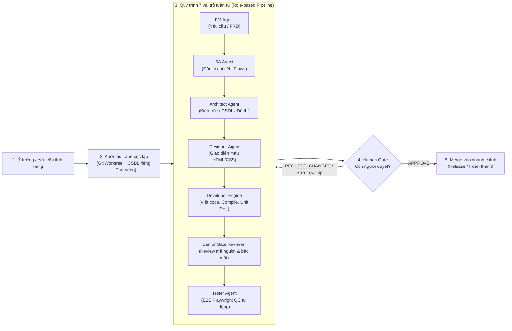
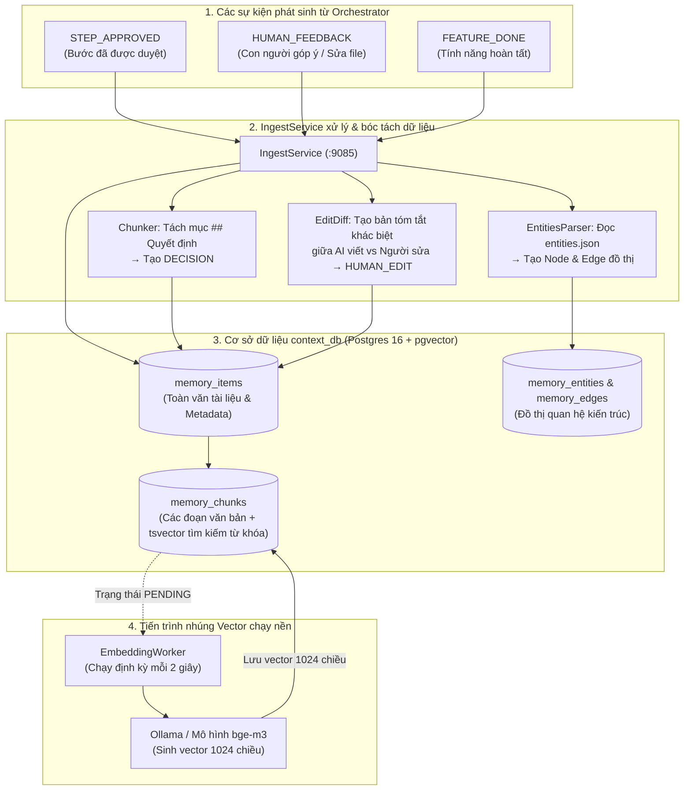
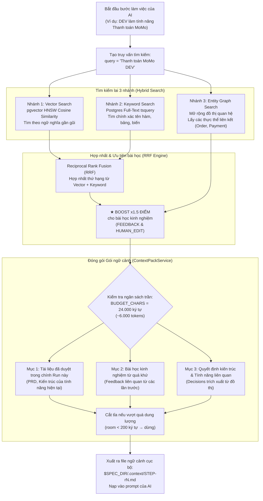
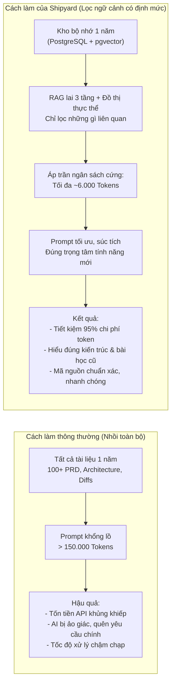

# Shipyard — Nguyên lý hoạt động & Kiến trúc Bộ nhớ Dự án

Tài liệu này giải thích chi tiết về:
1. **Nguyên lý hoạt động tổng thể** của Shipyard (Multi-lane Harness, Role Pipeline, Human-in-the-loop).
2. **Kiến trúc và Logic nghiệp vụ của Bộ nhớ dự án** (`context-service`), kèm sơ đồ minh họa quy trình lưu trữ và truy xuất.
3. **Bài toán thực tế**: Sau 1 năm vận hành với hàng trăm tính năng, khi có yêu cầu mới thì AI đọc tài liệu như thế nào để vừa hiểu sâu dự án vừa tiết kiệm token tối đa.

---

## 1. Nguyên lý hoạt động tổng thể của Shipyard

Shipyard không hoạt động như một chatbot AI thông thường. Thay vào đó, Shipyard là một **Engineering Control Plane & Multi-Lane Delivery Harness** (Hệ thống điều phối phân phối phần mềm bằng AI theo quy trình kỹ thuật chuẩn mực).

### Các nguyên tắc nền tảng:
1. **Phân làn song song (Multi-lane Isolation)**:
   - Mỗi tính năng chạy trên 1 **Lane** riêng biệt (ví dụ `lane-1`, `lane-2`).
   - Mỗi Lane sở hữu: 1 Git worktree độc lập, 1 schema database riêng biệt, và cổng dịch vụ riêng. Các lập trình viên hoặc AI làm việc đồng thời trên nhiều tính năng mà không lo xung đột mã hay ghi đè dữ liệu thử nghiệm.
2. **Quy trình vai trò chuẩn mực (Separation of Concerns)**:
   - Công việc phần mềm được chia nhỏ cho 7 vai trò chuyên biệt (`PM → BA → ARCH → DESIGN → DEV → REVIEW → TEST`).
   - Mỗi bước có bộ chỉ dẫn riêng (System Prompt), quyền hạn riêng, và công cụ riêng, đảm bảo tính chặt chẽ trước khi bắt tay vào gõ code.
3. **Con người kiểm soát và định hướng (Human-in-the-loop)**:
   - Tại mỗi bước, kết quả do AI tạo ra (PRD, kiến trúc, mockup HTML, mã nguồn) đều được gửi về giao diện chờ con người đánh giá.
   - Con người có quyền: `APPROVE` (duyệt), `REQUEST_CHANGES` (yêu cầu sửa kèm lời dặn), hoặc **tự tay sửa trực tiếp tài liệu** (`edits`). Bản sửa của con người sẽ trở thành gốc để AI làm tiếp.

---

## 2. Kiến trúc & Logic nghiệp vụ của Bộ nhớ Dự án (`context-service`)

Bộ nhớ của mỗi dự án trong Shipyard được quản lý tập trung bởi microservice **`context-service`** (cổng `:9085`), lưu trữ trong PostgreSQL kết hợp tiện ích mở rộng vector `pgvector`.

### 2.1 Năm nhóm dữ liệu hạt nhân của Bộ nhớ
Thay vì lưu lại toàn bộ lịch sử hội thoại dài dòng, Shipyard chỉ chắt lọc và phân loại thành 5 thực thể cốt lõi:

| Thực thể | Nguồn gốc tạo ra | Ý nghĩa nghiệp vụ |
| :--- | :--- | :--- |
| **`ARTIFACT`** | Tài liệu chính thức đã được người duyệt (`product-brief.md`, `architecture.md`, `plan.md`). | Làm tài liệu tham chiếu chuẩn mực cho toàn bộ dự án. |
| **`DECISION`** | Trích xuất tự động từ mục `## Quyết định` trong kiến trúc. | Ghi nhớ các quyết định kỹ thuật nền tảng (chọn DB, thư viện, cơ chế bảo mật) để AI không tự ý thay đổi. |
| **`FEEDBACK` & `HUMAN_EDIT`** | Lời từ chối, nhận xét của Reviewer và **các đoạn diff mà con người tự tay chỉnh sửa**. | **Bài học kinh nghiệm (Lessons)**. Đây là tài sản giá trị nhất để AI không lặp lại lỗi cũ của các lần trước. |
| **`FEATURE_SUMMARY`** | Tóm tắt ngắn gọn sau khi một tính năng hoàn thành và merge. | Giúp AI nắm được bức tranh tổng quan các chức năng đã có trong hệ thống. |
| **`Entities & Graph`** | Trích xuất từ file `entities.json` do Architect Agent tạo ra. | Đồ thị quan hệ giữa các thực thể phần mềm (ví dụ: `User` -> `Order` -> `Payment`). |

---

### 2.2 Sơ đồ Luồng Ghi nhận Bộ nhớ (Ingestion Logic)

Khi một bước hoàn thành hoặc khi có phản hồi từ con người, sự kiện được đẩy vào `context-service` xử lý bất đồng bộ theo quy trình:

---

### 2.3 Sơ đồ Luồng Truy xuất Bộ nhớ (Hybrid Retrieval & Context Pack Logic)

Khi một AI Agent bắt đầu làm việc trên một tính năng mới, hệ thống **không** lấy toàn bộ dữ liệu thô, mà áp dụng cơ chế tìm kiếm lai (Hybrid RAG) và cắt gọt theo định mức:

---

## 3. Dự án chạy 1 năm: Xử lý thế nào để tiết kiệm token tối đa mà AI vẫn hiểu dự án?

### 3.1 Vấn đề nan giải nếu làm theo cách thông thường
Sau 1 năm phát triển:
- Dự án có thể có **50-100 tính năng**, hàng nghìn commit, hàng trăm trang tài liệu PRD, tài liệu kiến trúc, tài liệu test.
- Nếu **nhồi toàn bộ tài liệu 1 năm vào Prompt** (Naive Context Injection):
  - Số lượng token tiêu thụ mỗi lượt lên đến **100.000 - 300.000 tokens**.
  - Chi phí API tăng vọt hàng trăm USD cho mỗi tính năng nhỏ.
  - Vượt quá giới hạn Context Window của mô hình.
  - Gây ra hiện tượng **loãng ngữ cảnh (Context Dilution)**: AI bị ngợp giữa hàng trăm tính năng cũ, dẫn đến trả lời lan man, ảo giác và làm sai lệch yêu cầu của tính năng hiện tại.

### 3.2 Bảng so sánh phương pháp tiếp cận

---

### 3.3 Bốn trụ cột giúp Shipyard tiết kiệm token tối đa sau 1 năm vận hành

#### Trụ cột 1: Ngân sách trần cứng về Token (`BUDGET_CHARS = 24_000`)
Được thiết kế trực tiếp trong mã nguồn [`ContextPackService.java`](../platform/context-service/src/main/java/com/shipyard/platform/context/service/ContextPackService.java):
- Giới hạn cứng **24.000 ký tự** (tương đương khoảng **6.000 tokens**).
- Ngân sách được chia đều: tối đa một nửa cho bài học kinh nghiệm (`FEEDBACK`), một nửa cho quyết định kiến trúc liên quan (`DECISION`).
- Khi tích lũy tài liệu đạt đến ngưỡng trần, hệ thống tự động cắt tỉa (`substring`) và ngắt (`break`), tuyệt đối không để prompt bị phình to vô hạn.

#### Trụ cột 2: Lọc đúng ngữ cảnh thông qua Đồ thị thực thể (Entity Graph)
- Khi thêm một tính năng mới (ví dụ: *"Hủy hóa đơn và hoàn tiền"*), AI Architect khai báo các thực thể bị tác động trong `entities.json` (ví dụ: `Invoice`, `RefundTransaction`).
- `context-service` chỉ đi theo các liên kết trong đồ thị liên quan đến `Invoice` và `RefundTransaction`.
- Toàn bộ các module khác của 1 năm qua (như `Quản lý nhân sự`, `Chấm công`, `Báo cáo kho`) bị **loại bỏ 100%** khỏi ngữ cảnh tìm kiếm.

#### Trụ cột 3: Nhân hệ số x1.5 điểm cho Bài học con người (Lessons Learned)
- Trong 1 năm, những lỗi mà AI từng mắc phải và đã được Tech Lead sửa tay hoặc phê bình (`FEEDBACK`, `HUMAN_EDIT`) sẽ được gán trọng số ưu tiên cao gấp **1.5 lần** so với văn bản thông thường.
- AI của tính năng mới sẽ đọc được chính xác: *"Trước đây khi xử lý giao dịch, Tech Lead đã dặn phải dùng transaction isolation level Serializable để tránh race condition"*. AI sẽ áp dụng ngay bài học đó mà không cần đọc lại toàn bộ code của cả năm.

#### Trụ cột 4: Cơ chế đọc mã nguồn theo nhu cầu (On-Demand Code Exploration) ở bước DEV
- Khi chuyển sang bước lập trình (`DEV`), Shipyard **không** tải toàn bộ codebase vào prompt.
- Thay vào đó, AI Agent sử dụng các công cụ dòng lệnh (như `grep`, `find`, `view_file`) để định vị và đọc đúng các file giao diện, model, controller mà tính năng mới trực tiếp tác động.
- Các tài liệu cũ đã lỗi thời được đánh dấu `superseded_by` hoặc có thể tắt thủ công (`disabled`) trực tiếp trên giao diện tab **Bộ nhớ dự án** của Shipyard Dashboard.

---

### Kết luận tóm tắt
Nhờ kiến trúc tách lớp và bộ nhớ thông minh của `context-service`:
1. **Dự án càng chạy lâu, token tiêu thụ mỗi tính năng vẫn giữ nguyên ở mức thấp và ổn định** (luôn bị chặn ở mức ~6.000 tokens).
2. **AI không bao giờ bị "lạc lối" giữa khối lượng tài liệu khổng lồ của quá khứ**, vì nó chỉ nhận đúng những mảnh ghép kiến trúc liên quan.
3. **Chất lượng code tăng dần theo thời gian**, bởi các bài học và góp ý của con người được ghi nhớ và ưu tiên áp dụng vào các tính năng tương lai.
