# Shipyard — Thiết kế hệ thống (as-built)

> **Phạm vi:** mô tả hệ thống **đúng như mã nguồn hiện tại** trong thư mục `shipyard/` (cập nhật 2026-10-20), không phải bản định hướng. Bản định hướng ban đầu là `Shipyard Platform – Thiết kế kiến trúc microservices.md`; mục [§17](#17-khác-biệt-so-với-bản-định-hướng--nợ-kỹ-thuật) liệt kê chỗ nào hệ thống thật khác bản đó.
>
> Sơ đồ viết bằng **Mermaid** — xem được trực tiếp trên GitHub/GitLab, VS Code (Markdown Preview Mermaid), IntelliJ (plugin Mermaid).

## Sơ đồ tổng thể


> Đọc theo số ①→⑪. Nguồn Mermaid: [`so-do-tong-the.mmd`](so-do-tong-the.mmd) · bản vector: [`so-do-tong-the.svg`](so-do-tong-the.svg).

## Mục lục
1. [Tổng quan](#1-tổng-quan)
2. [Kiến trúc tổng thể (container)](#2-kiến-trúc-tổng-thể-container)
3. [Bản đồ cổng & tiến trình](#3-bản-đồ-cổng--tiến-trình)
4. [Shipyard Platform — các microservice](#4-shipyard-platform--các-microservice)
5. [Xác thực & phân quyền](#5-xác-thực--phân-quyền)
6. [Orchestrator — máy trạng thái quy trình vai trò](#6-orchestrator--máy-trạng-thái-quy-trình-vai-trò)
7. [Context service — bộ nhớ dự án](#7-context-service--bộ-nhớ-dự-án)
8. [Lược đồ dữ liệu](#8-lược-đồ-dữ-liệu)
9. [Harness — lane & pipeline /ship-feature](#9-harness--lane--pipeline-ship-feature)
10. [Vòng lặp vai trò: lane ↔ platform ↔ con người](#10-vòng-lặp-vai-trò-lane--platform--con-người)
11. [Định tuyến model AI & chi phí](#11-định-tuyến-model-ai--chi-phí)
12. [Dashboard (BFF + SPA)](#12-dashboard-bff--spa)
13. [Bộ sinh dự án & Đội AI](#13-bộ-sinh-dự-án--đội-ai)
14. [Bảo mật](#14-bảo-mật)
15. [Bố cục thư mục & trạng thái trên đĩa](#15-bố-cục-thư-mục--trạng-thái-trên-đĩa)
16. [Vận hành & kiểm thử](#16-vận-hành--kiểm-thử)
17. [Khác biệt so với bản định hướng & nợ kỹ thuật](#17-khác-biệt-so-với-bản-định-hướng--nợ-kỹ-thuật)

---

## 1. Tổng quan

Shipyard là **hệ thống giao việc cho AI theo dây chuyền, có cổng duyệt của con người**. Nó gồm ba khối chạy trên cùng một máy chủ phát triển:

| Khối | Công nghệ | Vai trò |
|---|---|---|
| **Harness** (`bin/`, `claude/`, `profiles/`) | Bash + Python stdlib + Claude Code | Quản lý *lane* — bản clone độc lập của repo ứng dụng với cổng/DB riêng — và chạy pipeline `/ship-feature` (code → CI → e2e → review → QC → PR → QC sau merge). |
| **Shipyard Platform** (`platform/`) | Java 21, Spring Boot 3.3, Spring Cloud Gateway, PostgreSQL 16 + pgvector, Ollama | Người dùng, dự án, phân quyền theo vai trò, **orchestrator** quy trình PM→BA→ARCH→DESIGN→DEV→TEST với cổng duyệt, **bộ nhớ dự án** (RAG). |
| **Dashboard** (`dashboard/`) | Node.js (Express) BFF + React 18 / Vite SPA | Giao diện điều khiển: lane, chat với phiên AI, hộp duyệt, tài liệu, chi phí, người dùng, dự án, **tạo dự án từ khung**, **Đội AI**. |

Nguyên tắc xuyên suốt:
- **Con người merge, AI không bao giờ push nhánh tích hợp** (`development`/`develop`). AI chỉ đẩy nhánh feature và mở PR sau khi qua cổng GO.
- **Mỗi bước vai trò cần người có đúng vai trò duyệt** (hoặc Owner thay khi dự án chưa có ai giữ vai trò đó).
- **Mọi thứ đặc thù của ứng dụng nằm trong profile** (`profiles/<name>/hooks/*.sh`), harness không biết stack của app.

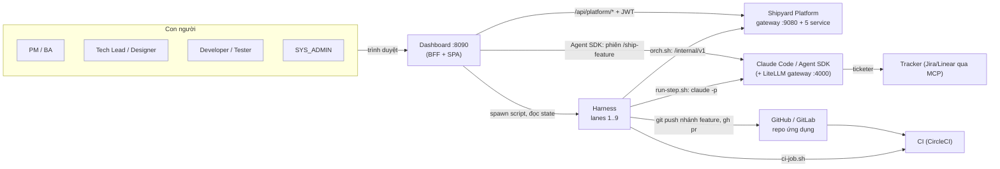

---

## 2. Kiến trúc tổng thể (container)

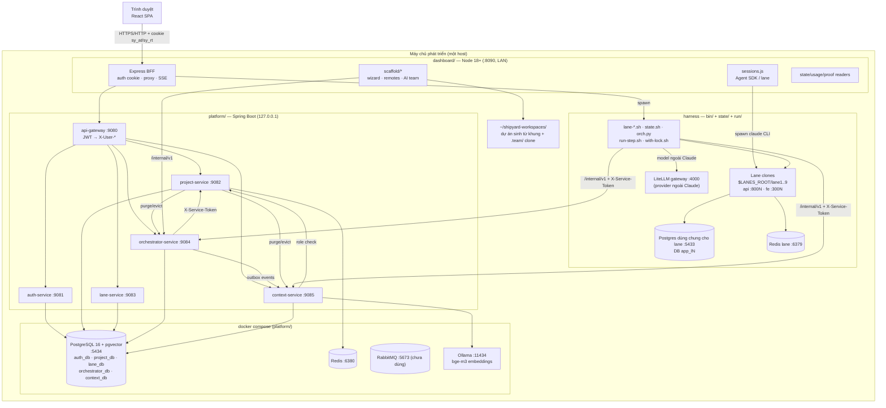

**Luồng gọi chính**
- Trình duyệt **không** gọi platform trực tiếp: gateway chỉ lắng nghe `127.0.0.1`; dashboard là BFF giữ JWT trong cookie HttpOnly và proxy `/api/platform/*` → `/api/v1/*`.
- Harness và dashboard gọi **API nội bộ** `/internal/v1/*` của orchestrator/context **trực tiếp** (không qua gateway), xác thực bằng header `X-Service-Token`.

---

## 3. Bản đồ cổng & tiến trình

| Tiến trình | Cổng | Bind | Khởi động | Ghi chú |
|---|---|---|---|---|
| Dashboard (Express) | 8090 | `0.0.0.0` (LAN, cấu hình `DASHBOARD_HOST`) | `bin/dashboard.sh start\|restart` | Phục vụ SPA `dashboard/dist` + API |
| api-gateway | 9080 | `127.0.0.1` (`GATEWAY_BIND_ADDR`) | `bin/platform.sh start` | Spring Cloud Gateway (WebFlux) |
| auth-service | 9081 | localhost | 〃 | `auth_db` |
| project-service | 9082 | 〃 | 〃 | `project_db`, Redis |
| lane-service | 9083 | 〃 | 〃 | `lane_db` |
| orchestrator-service | 9084 | 〃 | 〃 | `orchestrator_db` (Flyway) |
| context-service | 9085 | 〃 | 〃 | `context_db` (Flyway + pgvector) |
| PostgreSQL (platform) | 5434 | 127.0.0.1 | `platform.sh infra-up` (compose) | image `pgvector/pgvector:pg16` |
| Redis (platform) | 6380 | 127.0.0.1 | 〃 | cache phân quyền |
| RabbitMQ | 5673 / UI 15673 | 127.0.0.1 | 〃 | khai báo nhưng chưa service nào dùng |
| Ollama | 11434 | 127.0.0.1 | native hoặc container | model `bge-m3` (1024 chiều) |
| LiteLLM gateway | 4000 | 127.0.0.1 | `bin/gateway.sh` | proxy Anthropic-compatible tới OpenAI/Gemini/… |
| Postgres cho lane | 5433 | 127.0.0.1 | `bin/db-shared-up.sh` | DB `${DB_PREFIX}N` mỗi lane |
| Redis cho lane | 6379 | 127.0.0.1 | 〃 | |
| Lane N — API / FE | `8000+N` / `3000+N` | localhost | `lane-up.sh N` | theo profile (`API_BASE_PORT`, `FE_BASE_PORT`) |

---

## 4. Shipyard Platform — các microservice

Maven multi-module `platform/pom.xml` (Spring Boot 3.3.4, Java 21): `common-lib`, `auth-service`, `project-service`, `lane-service`, `orchestrator-service`, `context-service`, `api-gateway`.

### 4.1 `common-lib`
- `dto/ApiResponse{success,message,data,timestamp}` — mọi API trả về bọc này.
- `security/JwtUtils` (HS256, claims `sub`=userId, `email`, `role`), `SecurityConstants` (`X-User-Id`, `X-User-Email`, `X-User-Role`).
- `web/ServiceTokenFilter` — chặn `/internal/**` nếu thiếu `X-Service-Token` đúng.
- `directory/HttpProjectDirectory` + `TtlCache` — các service hỏi project-service "user X có vai trò gì trong dự án Y" và cache theo TTL.
- `enums`: `SystemRole{SYS_ADMIN,USER}`, `ProjectRole` (kèm tập permission), `LaneType`, `LaneStatus`.
- `exception/*` → mã HTTP thống nhất (400/401/403/404/409/503).

### 4.2 api-gateway (:9080)
`JwtAuthenticationFilter` (global filter):
1. Xoá mọi header `X-User-*` do client gửi (chống giả mạo).
2. Bỏ qua các đường public (`/api/v1/auth/login|register|refresh`).
3. Xác thực `Authorization: Bearer <JWT>` → gắn `X-User-Id/Email/Role` rồi chuyển tiếp.

Bảng định tuyến (thứ tự ưu tiên `order` nhỏ trước):

| Route | Đường dẫn | Đích |
|---|---|---|
| orchestrator (order −10) | `/api/v1/runs/**`, `/api/v1/approvals/**`, `/api/v1/projects/*/gate-policy`, `/api/v1/projects/*/runs` | :9084 |
| context (−10) | `/api/v1/projects/*/memory/**` | :9085 |
| lane-service-project-lanes (−5) | `/api/v1/projects/{id}/lanes/**` | :9083 |
| auth-service | `/api/v1/auth/**` | :9081 |
| project-service | `/api/v1/projects/**` | :9082 |
| lane-service-lanes | `/api/v1/lanes/**` | :9083 |

### 4.3 Danh mục API

**auth-service** (`/api/v1/auth`)

| Method | Path | Mô tả |
|---|---|---|
| POST | `/register`, `/login`, `/refresh`, `/logout` | Phiên: access JWT 900s + refresh token 7 ngày (lưu **hash** trong DB, thu hồi được) |
| GET | `/me`, `/users?ids=`, `/users/lookup?email=` | Hồ sơ công khai cho danh sách thành viên |
| GET/POST/PATCH | `/admin/users[/{id}]`, POST `/admin/users/{id}/password` | Quản trị người dùng (SYS_ADMIN) |
| POST | `/me/password` | Đổi mật khẩu |

Khoá đăng nhập: `failedLoginCount` + `lockedUntil` trên `User`.

**project-service** (`/api/v1/projects`, nội bộ `/internal/v1`)

| Method | Path | Mô tả |
|---|---|---|
| POST/GET | `/`, `/{idOrSlug}` | Tạo (người tạo thành OWNER) / liệt kê / xem dự án (`repoUrl`, `defaultBranch`, `currentUserRoles`) |
| DELETE | `/{id}?confirm=<slug>` | Xoá (Owner, gõ lại slug) → gọi purge orchestrator + context |
| GET/POST/DELETE | `/{id}/members[/{userId}]` | Thành viên **nhiều vai trò** (V2) |
| GET | `/{id}/check-permission` | Kiểm tra quyền |
| GET (internal) | `/projects/{id}/members/{uid}/roles`, `/projects/{id}/role-holders`, `/users/{uid}/memberships` | Cho orchestrator/context/dashboard |

**lane-service** — `POST/GET /projects/{id}/lanes`, `GET/DELETE /lanes/{id}`; `SlotAllocatorService` cấp slot số nhỏ nhất còn trống (xem §17: harness chưa dùng).

**orchestrator-service** — xem §6. **context-service** — xem §7.

### 4.4 Giao tiếp giữa các service

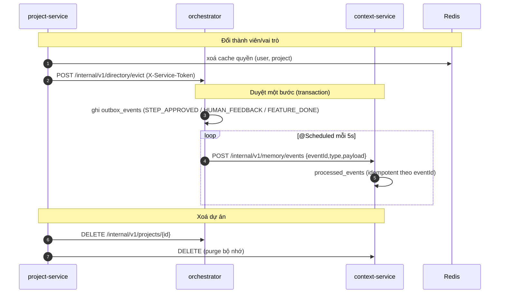

- **Transactional outbox**: orchestrator ghi sự kiện trong cùng transaction với quyết định duyệt; publisher gửi lại với backoff (`attempts`, `next_attempt_at`, `last_error`) → không mất sự kiện khi context-service tạm chết.
- **ProjectDirectory + TtlCache**: orchestrator/context hỏi vai trò qua HTTP, cache ngắn; project-service chủ động `evict` khi vai trò đổi.

---

## 5. Xác thực & phân quyền

### 5.1 Hai tầng vai trò

| Tầng | Giá trị | Nơi lưu |
|---|---|---|
| Hệ thống | `SYS_ADMIN`, `USER` | `auth_db.users.system_role`, claim `role` trong JWT |
| Dự án (nhiều vai trò/người) | `OWNER`, `MAINTAINER`, `PM`, `BA`, `TECH_LEAD`, `DESIGNER`, `DEVELOPER`, `TESTER`, `VIEWER` | `project_db.project_members` |

### 5.2 Ai duyệt bước nào

| Bước | Vai trò bắt buộc | Tài liệu bắt buộc khi nộp |
|---|---|---|
| PM | PM | `spec.md` |
| BA | BA | `ba.md` |
| ARCH | TECH_LEAD | `plan.md`, `tasks.md`, `entities.json` (JSON object) + `hasUi` |
| DESIGN | DESIGNER | `design.md` + ≥1 ảnh |
| DEV | DEVELOPER | `meta.branch` |
| TEST | TESTER | `qc-plan.md` + ≥1 ảnh |
| MANAGER (run SETUP) | TECH_LEAD | `project.md`, `team.json` |

`GatePermission.decideAs`: người có đúng vai trò → duyệt với vai trò đó; nếu **dự án chưa ai giữ vai trò đó** và người dùng là OWNER → duyệt với tư cách `OWNER_FALLBACK`. Giới hạn tổng tài liệu 1 MB/lần nộp.

### 5.3 Luồng đăng nhập (dashboard là BFF)

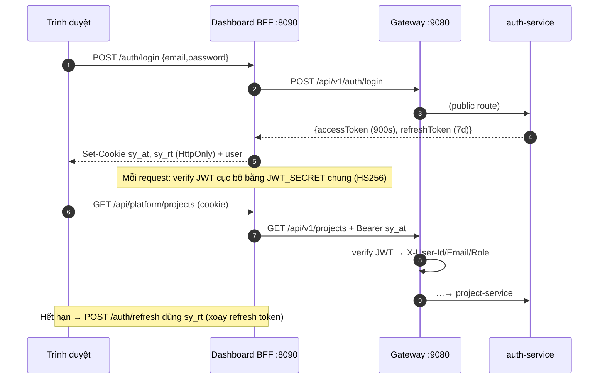

- `JWT_SECRET` dùng chung giữa platform và dashboard: lấy từ `config/secrets.env`, nếu trống thì `platform.sh` sinh `run/platform/jwt-secret` theo máy.
- `SHIPYARD_SERVICE_TOKEN` tương tự (`run/platform/service-token`), dùng cho mọi `/internal/v1`.

---

## 6. Orchestrator — máy trạng thái quy trình vai trò

### 6.1 Khái niệm
- **Run** = một tính năng (`kind=FEATURE`) hoặc một lần soạn luật đội AI (`kind=SETUP`), gắn `projectId` + `laneRef` (`<host>:lane<N>` hoặc `<host>:setup:<slug>`).
- **RunStep** = trạng thái từng bước; **StepRevision** = mỗi lần AI nộp (tài liệu, ảnh, meta, context đã dùng, bản đã duyệt); **ApprovalRequest** = yêu cầu duyệt cho một revision.
- FEATURE dùng các bước PM→BA→ARCH→DESIGN→DEV→TEST; SETUP chỉ có MANAGER.
- Dự án đã có run SETUP nhưng chưa có cái nào DONE → **chặn tạo run FEATURE** (phải có luật được duyệt trước). Chỉ được một run SETUP mở mỗi dự án.

### 6.2 Trạng thái run & bước

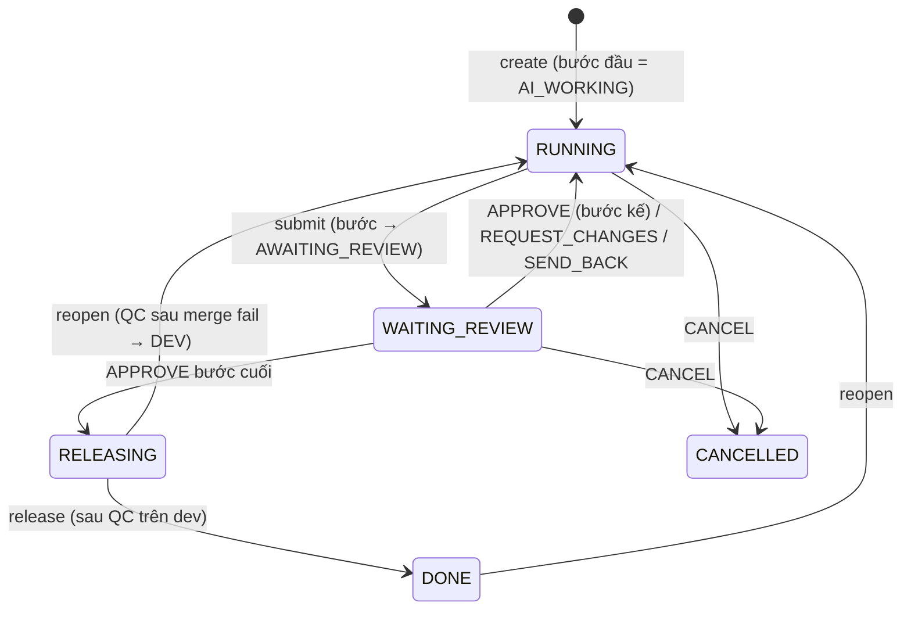

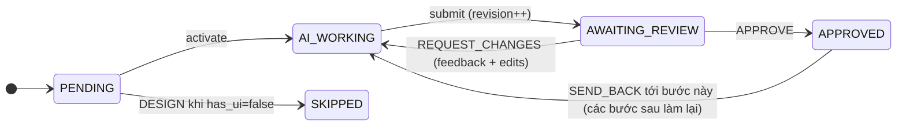

**Quy tắc cứng**
- DEV chỉ bắt đầu khi PM, BA, ARCH **APPROVED** và DESIGN APPROVED (hoặc SKIPPED vì `has_ui=false`).
- `SEND_BACK` chỉ về **bước trước**, không về bước bị SKIPPED.
- `REQUEST_CHANGES` bắt buộc có `feedback`; reviewer có thể **sửa trực tiếp tài liệu** (`edits`) — bản người sửa thành gốc cho lần làm lại.
- **Gate policy** theo dự án (`gate_policies`) và ghi đè theo run (`runs.gate_overrides`): `AUTO` = tự duyệt khi nộp (trừ MANAGER — luôn cần người).

### 6.3 `GET /internal/v1/runs/{id}/next` — lane hỏi "giờ làm gì?"

| `mode` | Ý nghĩa | Lane làm |
|---|---|---|
| `WORK` | Bước hiện tại đang chờ AI làm lần đầu | chạy agent của bước |
| `REVISE` | Có feedback/edits | đồng bộ bản người sửa, chạy lại agent |
| `WAIT` | Đang chờ người duyệt | dừng lượt, chờ được đánh thức |
| `RELEASE` | Mọi bước đã duyệt | senior gate → push → PR → chờ merge → QC dev |
| `DONE` / `CANCELLED` | Kết thúc | dọn lane |

### 6.4 API orchestrator

| Loại | Method & Path | Ghi chú |
|---|---|---|
| Nội bộ | `POST /internal/v1/runs` | `{projectId, laneRef, title, description, createdBy, kind, gateOverrides?}` |
| | `GET /internal/v1/runs/{id}/next` | xem §6.3 (kèm `priorApproved`, `feedback`, `editedDocuments`, `revision`) |
| | `POST /internal/v1/runs/{id}/steps/{STEP}/submit` | `{summary, documents, images, meta, contextUsed, hasUi?}` |
| | `POST …/reopen`, `POST …/release` | |
| | `POST /internal/v1/directory/evict`, `DELETE /internal/v1/projects/{id}` | |
| Người dùng (qua gateway) | `GET /api/v1/approvals/inbox` | việc chờ tôi duyệt |
| | `POST /api/v1/approvals/{id}/decision` | `{action: APPROVE\|REQUEST_CHANGES\|SEND_BACK\|CANCEL, feedback, edits, sendBackTo, hasUi}` |
| | `GET /api/v1/runs/{id}`, `/runs/{id}/revisions/{revId}` | xem run/revision |
| | `GET/PUT /api/v1/projects/{id}/gate-policy`, `GET /projects/{id}/runs` | |

Đồng thời: các entity có cột `version` (optimistic locking) → hai người duyệt cùng lúc sẽ có một người nhận 409.

---

## 7. Context service — bộ nhớ dự án

Mục đích: mỗi bước AI nhận **context pack** — những gì dự án đã quyết định trước đây (tài liệu đã duyệt, phản hồi của người duyệt, tóm tắt tính năng đã xong) — để không lặp lại lỗi cũ.

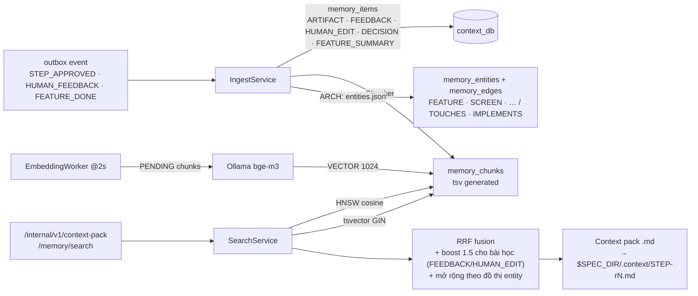

- **Tìm kiếm lai**: vector (pgvector HNSW, ngưỡng điểm tối thiểu) + từ khoá (Postgres full-text `simple`), hợp nhất bằng **Reciprocal Rank Fusion**, mỗi item lấy chunk tốt nhất, `k` mặc định 8 (tối đa 50).
- **Chế độ suy giảm**: Ollama không có hoặc model sai chiều → **không lỗi**, chỉ dùng từ khoá + đồ thị (`degraded=true`).
- **Phiên bản**: tài liệu mới cùng `source_ref` → bản cũ `superseded_by`. Người dùng có thể **tắt** mục (`disabled`) ở tab *Bộ nhớ dự án*; `POST /memory/reembed` để nhúng lại.
- API nội bộ: `POST /memory/events`, `POST /memory/search`, `GET /memory/items/{id}`, `GET /memory/related?type&key`, `POST /context-pack`. API người dùng: `GET/PATCH /api/v1/projects/{id}/memory[/{itemId}]`, `POST …/memory/reembed`.

---

## 8. Lược đồ dữ liệu

Mỗi service một database trong cùng cụm Postgres (:5434). `orchestrator_db`, `context_db`, `project_db` (V2+) dùng **Flyway**; `auth`, `project`, `lane` còn dùng `ddl-auto: update` cho phần gốc.

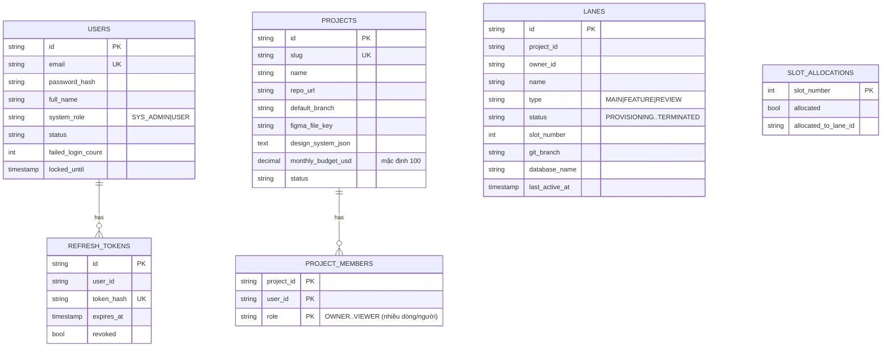

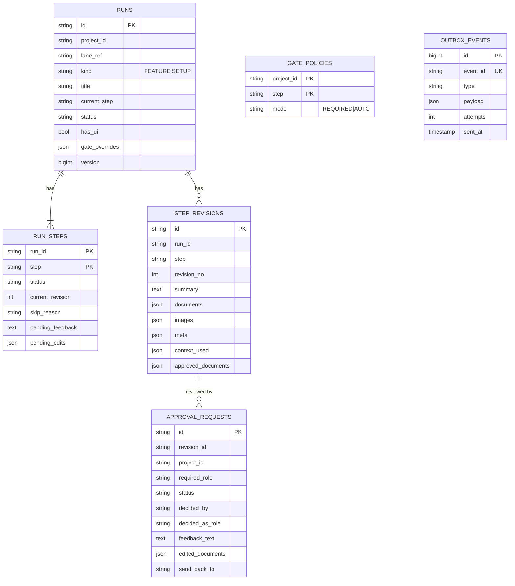

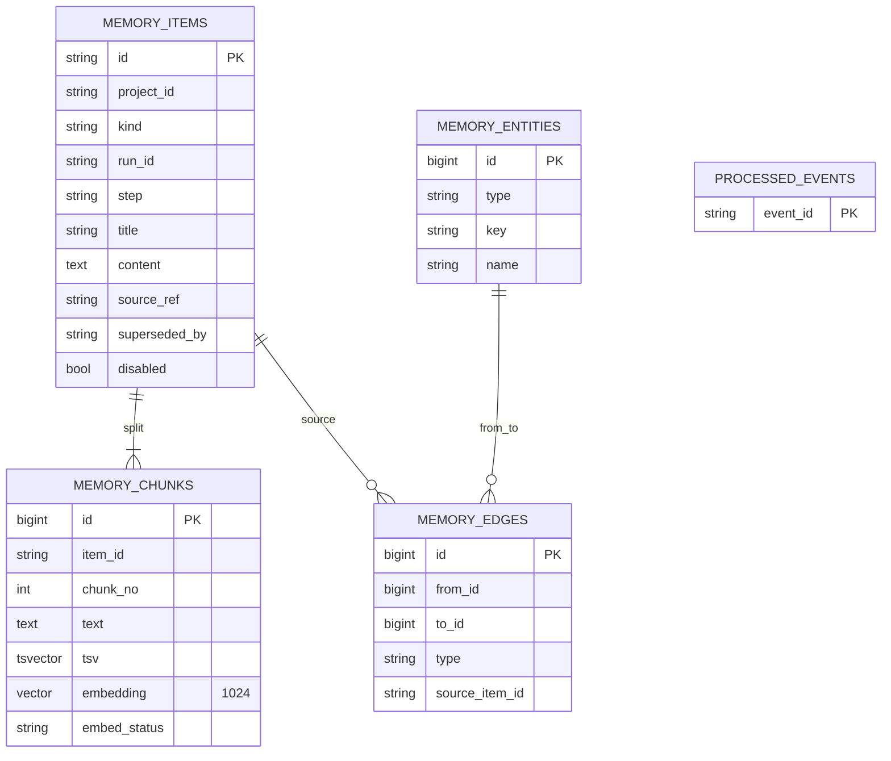

---

## 9. Harness — lane & pipeline `/ship-feature`

### 9.1 Mô hình lane
- **Lane N** (N = 1..9) = thư mục `$LANES_ROOT/laneN`: clone đầy đủ repo ứng dụng (`SOURCE_REPO`/`ORIGIN_URL`), DB riêng `${DB_PREFIX}N` trên Postgres dùng chung (:5433), cổng riêng API `8000+N` / FE `3000+N`, tài khoản QA riêng, Playwright MCP riêng.
- **Profile** (`profiles/<name>/`): `profile.env` (`BACKEND_DIR`, `FRONTEND_DIR`, `INTEGRATION_BRANCH`, `MIGRATIONS_DIR`, `QC_BOOT_ENV`, `IMPL_AGENTS`…) và hook `bootstrap.sh`, `migrate.sh`, `seed.sh`, `boot.sh`, `health.sh`, `ci-gate.sh`, `e2e.sh`, `regen.sh`. Harness chỉ gọi hook — không biết stack.
- **Cấu hình** phân lớp: `config/local.env` (máy) → `config/lanes.env` (mặc định) → biến môi trường (ưu tiên cao nhất). `config/secrets.env` cho token.

### 9.2 Vòng đời lane

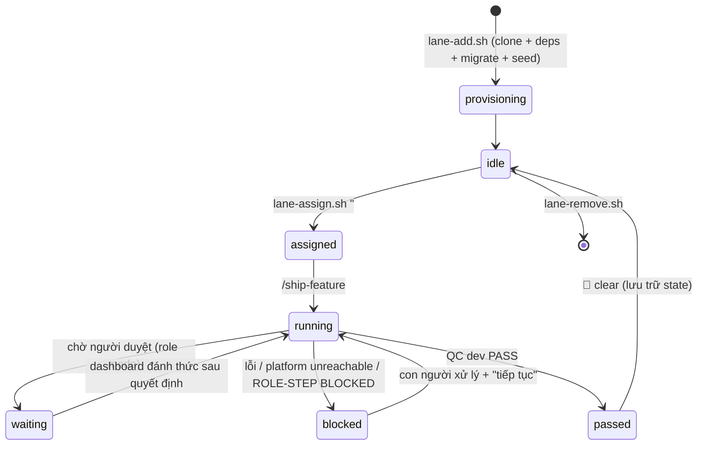

Trạng thái mỗi tính năng: `state/laneN/<slug>.json` (`.active` trỏ tính năng hiện tại) với các khoá `status, stage, stage_since, branch, pr_url, ticket_url, ci_status, gate_decision, qc_dev, spec_dir, needs_action, notes, steps[], last_heartbeat…`; ghi qua `bin/state.sh` (cập nhật bằng Python, có heartbeat).

### 9.3 Pipeline cổ điển (không có platform project)

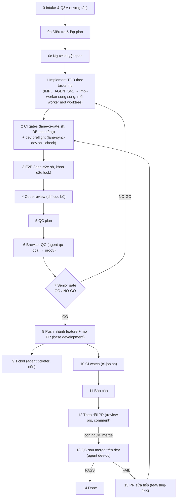

**Cơ chế an toàn**
- `with-lock.sh <name> -- cmd` và `lane-lock.sh acquire/release` (mkdir nguyên tử, phá khoá cũ sau 45 phút) → các bước nặng (`build`, `e2e`, `qc`, `integration`) chạy tuần tự giữa các lane.
- `lane-sync-dev.sh` là **merge duy nhất được phép**: `origin/$INTEGRATION_BRANCH` → nhánh feature (rerere, driver keep-ours, kiểm tra trùng số migration). Không bao giờ push nhánh tích hợp.
- `lane-gc.sh` dọn MCP/trình duyệt mồ côi, state cũ.
- `harness-doctor.sh` kiểm tra profile đủ để chạy.

### 9.4 Agent & skill (`claude/`, cài vào `~/.claude` bằng `install-claude-assets.sh`)

| Agent | Bước | Đầu ra |
|---|---|---|
| `pm-agent` | PM | `spec.md` (user story, AC đánh số, non-goals, câu hỏi mở) |
| `ba-agent` | BA | `ba.md` (actors, luồng chính/phụ, rule, dữ liệu, edge case) |
| `architect-agent` | ARCH | `plan.md`, `tasks.md`, `entities.json`, quyết định `has_ui` |
| `designer-agent` | DESIGN | mockup HTML → PNG desktop+mobile, `design.md` |
| `tester-agent` | TEST | `qc-plan.md`, chạy check tự động |
| `impl-worker` | DEV (song song) | code một nhóm task trong worktree riêng |
| `qc-local` | Stage 6 / TEST | QC trình duyệt, ảnh bằng chứng |
| `senior-gate-reviewer` | Stage 7 | `GO`/`NO-GO` + danh sách phải sửa |
| `ticketer` | Stage 9 | ticket tracker + báo cáo HTML |
| `dev-qc` | Stage 13 | `DEV-QC: PASS/FAIL` trên môi trường dev |
| `pr-reviewer` | `/review-prs` | review một PR, đăng nhận xét |
| `manager-agent` | MANAGER (SETUP) | `.shipyard/rules/*.md`, `.shipyard/team.json` |

Skill: `ship-feature`, `review-prs`, `qc-sweep`, `split-batch`, `harness-adapt`, `spec-new|plan|tasks|constitution`.

---

## 10. Vòng lặp vai trò: lane ↔ platform ↔ con người

Kích hoạt khi lane có `PLATFORM_PROJECT_ID` (gán trong lane env). Phiên chính trên lane là **nhạc trưởng**: không tự viết tài liệu vai trò mà gọi `run-step.sh` cho từng agent.

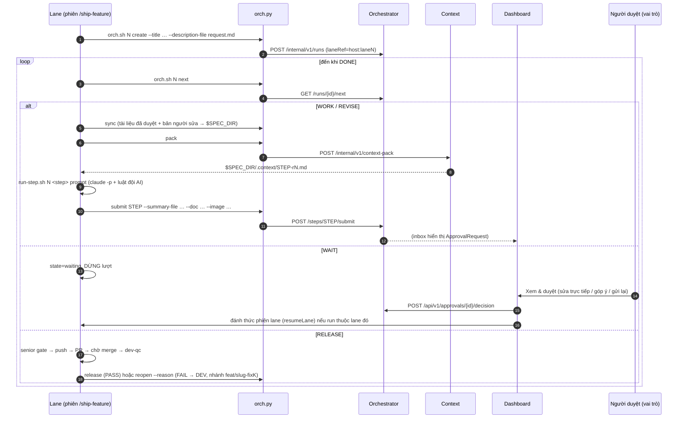

`orch.sh` mã thoát: `0` ok · `2` platform không truy cập được → lane `blocked` · `3` bị từ chối (thiếu tài liệu…) → sửa và nộp lại · `64` sai cú pháp.

---

## 11. Định tuyến model AI & chi phí

### 11.1 Chọn model cho từng bước

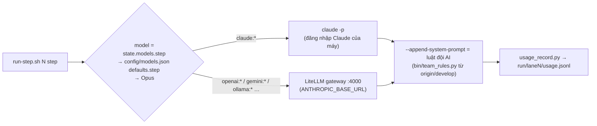

- Cấu hình model theo 3 mức: **mặc định chung** → **mặc định riêng lane** → **riêng tính năng** (tab *AI & Chi phí*, `PUT /api/features/models`). `effort` (low…max) theo bước, chỉ áp dụng cho model Claude.
- Provider ngoài Claude cấu hình ở *Nhà cung cấp* (`config/providers.json`, khoá API không gửi về trình duyệt); `gateway.sh` sinh config LiteLLM.

### 11.2 Chi phí (`dashboard/server/services/usage.js`)
- Nguồn: `run/laneN/usage.jsonl` (mỗi bước headless) + sự kiện Agent SDK của phiên chat.
- Quy đổi: giá API niêm yết (USD) × `usdToVnd`; hạn mức tháng (USD + token), cửa sổ 5 giờ / 7 ngày.
- Chi phí nhân công ước tính theo **giờ × đơn giá vai trò** (VND/giờ: PM 150k, BA 120k, Tech Lead 200k, Designer 120k, Dev 150k, Tester 100k) để so với chi phí AI.
- Màn *Chi phí*: theo lane, theo tính năng, theo dự án, theo model; thanh % hạn mức.

---

## 12. Dashboard (BFF + SPA)

### 12.1 Server (Express, `dashboard/server/`)

Thứ tự middleware: `express.json(5mb)` → `authRoutes` (`/auth/*`, public) → `requireAuth` (verify cookie JWT) → router nghiệp vụ → `express.static(dist)` (SPA fallback).

| Router | Endpoint | Chức năng |
|---|---|---|
| `auth.js` | `/auth/me\|login\|refresh\|logout` | phiên cookie |
| `platform.js` | `ALL /api/platform/*` | proxy tới gateway kèm Bearer; sau `approvals/{id}/decision` thành công → **đánh thức lane** sở hữu run (hoặc chuyển cho setup runner nếu là run SETUP) |
| `lanes.js` | `GET /api/lanes`, `POST /api/lane/:n/:action`, `POST /api/lanes/add` | trạng thái lane (poll 3s), hành động up/down/clear/reset… (spawn script) |
| `agentui.js` | `/api/providers`, `/api/models`, `/api/lane/:n/{assign,specs,models,usage,limit}`, `/api/lane/:n/chat/{stream,message,answer}`, `/session/{stop,resume}` | chat với phiên AI (SSE), giao việc, cấu hình model |
| `costs.js` | `/api/costs`, `/settings`, `/feature-hours` | chi phí |
| `proof.js` | `/api/proof/:n`, `/proof/:n/*`, `/spec/:n/*`, `/api/reviews/:n` | ảnh QC, file spec, lịch sử review PR |
| `creds.js` | `/api/lane/:n/creds-current` | tài khoản QA của lane |
| `scaffold.js` | `/api/scaffold/*` | wizard tạo dự án, kết nối GitHub/GitLab, trạng thái AI Manager (SYS_ADMIN) |
| `team.js` | `/api/team/:pid/*` | tab Đội AI (§13.4) |

**Phiên AI theo lane** (`services/sessions.js`): một session Claude Agent SDK / lane, streaming input giữ phiên mở qua nhiều lượt; mỗi message lọc thành sự kiện chat nhỏ, **che bí mật**, ghi `run/laneN/chat.jsonl` và đẩy SSE. Tiêm luật đội AI qua `extraArgs['append-system-prompt']`.

### 12.2 Client (React 18 + Vite, `dashboard/src/`)

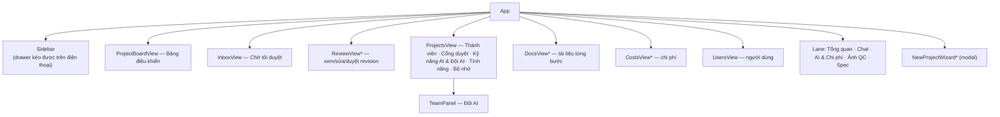
`*` = tải theo nhu cầu (`React.lazy`, chunk riêng).

- Dữ liệu: `useLanes` (poll 3s), `useInbox` (poll 10s), `useChat` (SSE), `lib/platform.js` (proxy), `lib/scaffold.js`, `lib/team.js`.
- Thiết kế: chế độ *Operate* (DESIGN.md) — token màu cho sáng/tối (`styles/tokens.css`, kể cả token chữ trạng thái đạt ≥4.5:1), vòng focus chung, vùng chạm ≥44px trên màn cảm ứng, `prefers-reduced-motion`.
- Chuyển động: `lib/spring.js` — spring Apple (damping ratio + response), có thể ngắt giữa chừng và giữ vận tốc; dùng cho `Modal` (bottom sheet kéo-để-đóng trên điện thoại) và drawer `Sidebar` (vuốt từ mép, chiếu đà quán tính).

---

## 13. Bộ sinh dự án & Đội AI

### 13.1 Wizard tạo dự án (SYS_ADMIN)

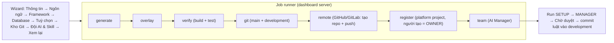

| Stack | Bộ sinh | Ghi chú |
|---|---|---|
| Java / Spring Boot | zip từ start.spring.io (Boot 4.1.x) | H2 cho test, `spring.mongodb.uri` |
| Python / FastAPI | template riêng của Shipyard | cần `uv` |
| TS / React + Vite | `create-vite@9.3.0 --template react-ts` | |
| TS / NestJS | `@nestjs/cli@12.0.8 new --skip-git` | |

Overlay chung: README, `.editorconfig`, `.env.example` (biến DB thống nhất `DB_HOST/PORT/NAME/USER/PASSWORD`, `MONGODB_URI`, `REDIS_*`), `.gitignore`, `docker-compose` cho DB đã chọn, CI (GitHub Actions / GitLab CI), `.shipyard/project.json`, `.shipyard/team.json`, `.shipyard/rules/*.md`, `CLAUDE.md` (import `@.shipyard/rules/project.md`), `.claude/skills/<id>/SKILL.md` theo skill đã chọn. Thư mục: `~/shipyard-workspaces/<slug>`.

**Push an toàn:** token provider truyền **một lần** qua `GIT_CONFIG_COUNT/KEY/VALUE` (`http.extraHeader`) — không nằm trên argv, `.git/config` hay log. Token lưu `config/git-providers.json` (mode 600, gitignored), không bao giờ gửi về trình duyệt.

### 13.2 Luật đội AI

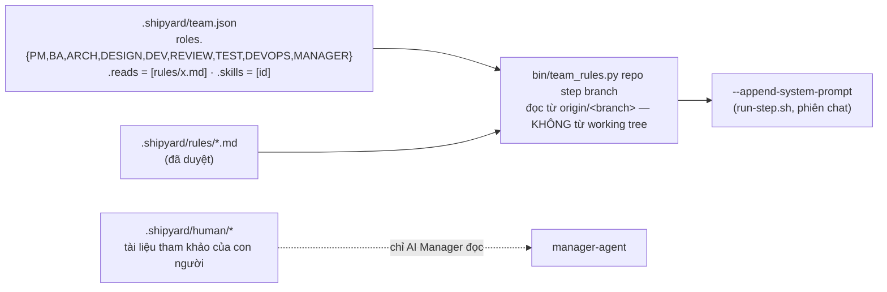
- Đọc luật từ nhánh tích hợp → nhánh feature (hoặc AI đang làm trên nó) **không tự sửa được luật của chính mình**.
- `.shipyard/human/` là *tài liệu*, không phải lệnh; không bao giờ được tiêm làm chỉ dẫn.

### 13.3 AI Manager (setup runner)

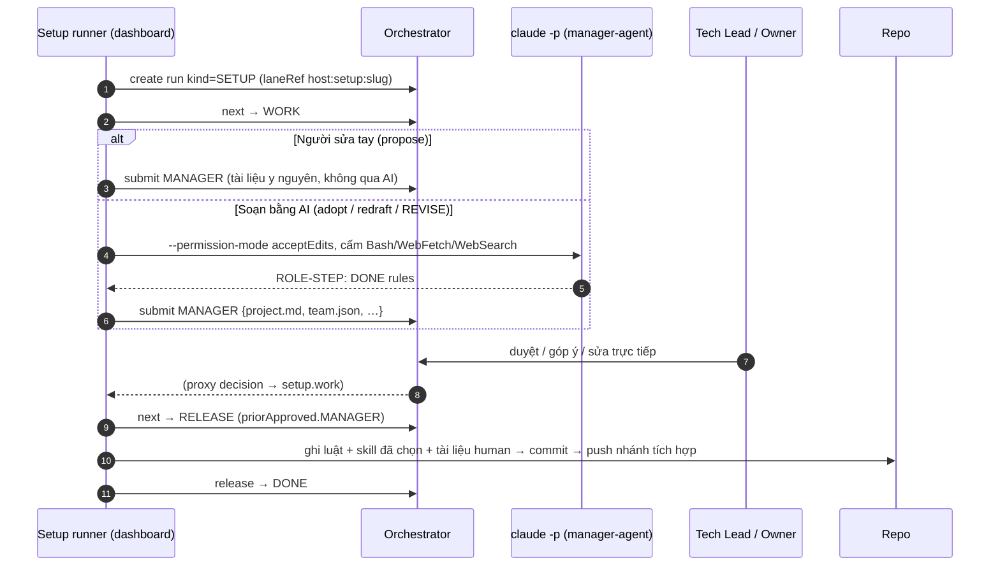
Trạng thái runner lưu `run/scaffold/setups.json` → quyết định đến sau khi dashboard khởi động lại vẫn đúng dự án.

### 13.4 Tab "Đội AI" (`/api/team/:pid`)
- Thành viên xem; **OWNER / MAINTAINER / TECH_LEAD / SYS_ADMIN** sửa (kiểm tra qua platform bằng token người gọi).
- Làm việc trên: workspace của wizard, hoặc **clone riêng** `~/shipyard-workspaces/.team/<slug>` (không đụng checkout của người dùng). Credential: token provider nếu host khớp, ngược lại credential git của máy. Nhánh luật = `defaultBranch` của dự án, ghi đè được (`.team/branches.json`) khi repo dùng nhánh khác (vd. `develop`).
- Hành động: **Thiết lập đội AI** (adopt: bộ luật khởi đầu chung + AI đọc code thật), **sửa ma trận ai-đọc-luật-nào / skill / file luật** (propose — gửi duyệt nguyên văn), **tải tài liệu** (≤3MB, commit cùng lần duyệt sau), **Soạn lại luật** (redraft kèm ghi chú). Một run SETUP mở mỗi dự án.

---

## 14. Bảo mật

| Chủ đề | Cơ chế hiện tại |
|---|---|
| Biên mạng | Platform chỉ bind `127.0.0.1`; chỉ dashboard mở LAN. Postgres/Redis/RabbitMQ/Ollama bind localhost. |
| Phiên người dùng | JWT HS256 15 phút trong cookie HttpOnly; refresh token 7 ngày lưu dạng hash, xoay vòng, thu hồi được; khoá tài khoản sau nhiều lần sai. |
| Giả mạo danh tính | Gateway xoá `X-User-*` đến từ client, chỉ đặt lại sau khi verify JWT. |
| Service-to-service | `X-Service-Token` bắt buộc trên `/internal/**`; token sinh theo máy, không dùng giá trị dev công khai. |
| Bí mật | `config/secrets.env`, `run/platform/{jwt-secret,service-token}`, `config/providers.json`, `config/git-providers.json` (600, gitignored); dashboard **lọc env** khi spawn toolchain (`childEnv`), che bí mật trong chat log. |
| Git | Token truyền qua `GIT_CONFIG_*` một lần; hook/ký commit của máy bị vô hiệu khi harness commit (`core.hooksPath=/dev/null`). |
| Prompt injection | Yêu cầu, tóm tắt PR, báo cáo QC = dữ liệu không tin cậy → ghi file bằng heredoc có nháy; tài liệu `human/` không bao giờ thành chỉ dẫn; AI Manager không có Bash/Web. |
| Tính toàn vẹn luật | Luật đọc từ nhánh tích hợp đã duyệt, không từ working tree. |
| Upload | Tên file theo whitelist đuôi; HTML/XML/SVG trả về `text/plain` + CSP `sandbox`. |
| **Chưa có** | Sandbox container cho AI (AI chạy trực tiếp trên host với quyền người dùng); virtual key LLM theo dự án. Xem §17. |

---

## 15. Bố cục thư mục & trạng thái trên đĩa

```
shipyard/
├─ bin/                 # harness: lane-*.sh, state.sh, orch.py, run-step.sh, platform.sh, dashboard.sh, gateway.sh, team_rules.py …
├─ claude/agents|skills # agent & skill (cài vào ~/.claude)
├─ profiles/<name>/     # profile.env + hooks/* (local, không commit)
├─ config/              # lanes.env, local.env, secrets.env, models.json, providers.json, git-providers.json
├─ state/laneN/         # <slug>.json (trạng thái tính năng), .active, _pending.json
├─ run/
│  ├─ laneN/            # *.pid, chat.jsonl, session.json, usage.jsonl, steps/
│  ├─ platform/         # jwt-secret, service-token, logs
│  └─ scaffold/         # setups.json (AI Manager)
├─ locks/               # khoá liên-lane (mkdir)
├─ logs/
├─ templates/roles|spec # mẫu tài liệu vai trò
├─ tests/               # test harness (bash/python)
├─ platform/            # Maven multi-module + docker-compose.yml + scripts/
├─ dashboard/           # server/ (Express) · src/ (React) · dist/ · test/ (vitest) · e2e/ (playwright)
└─ docs/                # tài liệu (file này)

$LANES_ROOT/laneN/      # clone repo ứng dụng cho lane N
~/shipyard-workspaces/  # dự án sinh từ khung; .team/<slug> = clone cho tab Đội AI
```

---

## 16. Vận hành & kiểm thử

| Việc | Lệnh |
|---|---|
| Hạ tầng platform | `bin/platform.sh infra-up` |
| Build + chạy platform | `bin/platform.sh build && bin/platform.sh restart` (`status` để xem 6 service) |
| Build giao diện + chạy dashboard | `cd dashboard && npx vite build && cd .. && bin/dashboard.sh restart` |
| Thêm lane / giao việc | `bin/lane-add.sh --and-up` · `bin/lane-assign.sh "<tiêu đề>"` (hoặc nút *Giao việc*) |
| Kiểm tra profile | `bin/harness-doctor.sh` |
| Test dashboard | `cd dashboard && npx vitest run` (≈246 test) · e2e: `node e2e/*.mjs` (cần platform + Chrome) |
| Test platform | `cd platform && mvn verify` (unit + IT, Testcontainers ở auth/project/orchestrator/context) |
| Test harness | `tests/run.sh` (bash + vitest) · `python3 tests/test_orch.py`, `python3 tests/test_team_rules.py` |

---

## 17. Khác biệt so với bản định hướng & nợ kỹ thuật

| Bản định hướng | Thực tế hiện tại | Hệ quả / hướng xử lý |
|---|---|---|
| lane-service cấp slot động cho mọi lane | Harness quản lý lane **riêng** (slot 1–9 theo `lanes.env`, `state/`); không gọi lane-service | Hai nguồn sự thật cho "lane". Hoặc nối harness vào lane-service, hoặc gỡ lane-service. |
| RabbitMQ cho sự kiện | Có trong compose, **không service nào dùng**; sự kiện đi bằng **HTTP outbox** | Gỡ khỏi compose hoặc chuyển outbox sang MQ khi cần nhiều consumer. |
| Redis nhiều mục đích | Chỉ project-service dùng làm cache quyền | OK; ghi rõ phụ thuộc. |
| Schema quản lý bằng migration | `auth`, `lane` (và phần gốc `project`) dùng `ddl-auto: update` | Rủi ro drift; nên chuyển hết sang Flyway. |
| Sandbox container cho AI | AI (Claude Code) chạy trên host, quyền của người dùng | Rủi ro bảo mật lớn nhất; cần container/VM cho lane hoặc ít nhất tài khoản OS riêng. |
| Virtual key / quota LLM theo dự án | Chỉ đo và cảnh báo (dashboard), không chặn | Cần enforce ở LiteLLM gateway nếu đa người dùng. |
| Figma MCP trong bước DESIGN | `designer-agent` dựng mockup HTML → PNG | `figma_file_key` có trong project nhưng chưa dùng. |
| GitHub App thay PAT | Dùng PAT/token chung theo provider | Token chung toàn hệ thống; nên chuyển GitHub App khi nhiều tổ chức. |
| Một máy chủ | Toàn bộ chạy trên một host | Đủ cho đội nhỏ; scale ngang cần tách harness khỏi dashboard và hàng đợi job. |
| Mã nguồn | Một phần code tính năng (Đội AI, bộ sinh dự án, UI) đang **chưa commit** trong `main` (PR #14–#18 + thay đổi cục bộ) | Cần gộp/commit để bản thiết kế này khớp với lịch sử git. |
